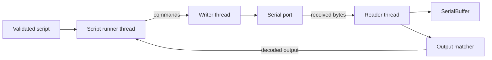

# Concepts

How the Serial MCP server works, and how the pieces fit together.

---

## How the agent interacts with devices

The server gives an AI agent (like Claude) a set of serial tools over the MCP protocol. The agent uses these tools to\
talk to real hardware — listing ports, opening connections, sending commands, and reading responses.

Everything is **stateful**: connections persist across tool calls. The agent doesn't have to re-open the port between\
each operation.

```
┌─────────────┐       stdio/MCP        ┌──────────────────┐      serial       ┌──────────┐
│  AI Agent   │ ◄────────────────────► │ Serial MCP Server │ ◄──────────────► │  Device  │
│ (Claude etc)│   structured JSON      │  (this project)   │    pyserial      │          │
└─────────────┘                        └──────────────────┘                   └──────────┘
```

The agent sees tools like `serial.open`, `serial.write`, `serial.readline`. It calls them, gets structured JSON back,\
and reasons about what to do next.

---

## Security model

Plugins can execute arbitrary code, so they are opt-in:

| `SERIAL_MCP_PLUGINS` | Effect |
| -- | -- |
| *(unset)* | Plugins disabled — no loading, no discovery |
| `all` | All plugins in `.serial_mcp/plugins/` are loaded |
| `name1,name2` | Only named plugins are loaded |

The agent cannot bypass these flags. It can only use the tools the server exposes, and the server enforces the policy.

Path containment is enforced for all filesystem operations:

- **Plugins** must be inside `.serial_mcp/plugins/`
- **Specs** must be inside the project directory (parent of `.serial_mcp/`)
- **Traces** always write to `.serial_mcp/traces/trace.jsonl` (not configurable)

The agent is not a trusted principal — the server enforces all safety boundaries regardless of what the agent “wants”\
to do.

---

## Protocol specs — teaching the agent about your device

Specs are markdown files that describe a serial device's protocol: connection settings, message format, commands, and\
multi-step flows.

```
.serial_mcp/
  specs/
    my-device.md      # protocol documentation
```

The agent reads specs to understand what a device can do. Without a spec, the agent can still open a port and exchange\
data, but it won't know what commands to send or what responses mean.

### How specs help the agent

```
Without spec:                         With spec:
  "I opened /dev/ttyUSB0 at 115200.    "This is the GPS module. It uses
   I can send bytes but I don't          9600 baud, NMEA 0183 format.
   know what the device expects."        $GPGGA sentences contain lat/lon.
                                         Send $PMTK314,0,1,0,0,0,0*29
                                         to enable RMC-only output."
```

### Creating a spec

Tell the agent about your device's protocol — paste a datasheet, a link to docs, or just describe the commands in chat.\
The agent will create the spec file, register it, and use it in future sessions.

You can also write specs by hand. They're just markdown files with a small YAML header.

### How the agent uses specs

After opening a connection, the agent can check for registered specs, attach a matching one, and reference it\
throughout the session — looking up commands, expected responses, and multi-step flows as needed.

Specs are freeform markdown. The agent reads and reasons about them — there's no rigid schema to fight, so specs can\
evolve naturally with your protocol.

### Beyond the agent

Specs aren't just for the agent — they're structured protocol documentation that lives in your repo. If you're\
designing a new serial protocol, specs created during agent sessions become the foundation for official protocol docs.\
They capture what was discovered, tested, and verified through real device interaction.

---

## Plugins — giving the agent shortcut tools

Plugins add device-specific tools to the server. Instead of the agent manually composing write/read sequences, a plugin\
provides high-level operations like `gps.get_position` or `sensor.read_temp`. [Plugins](plugins.md) covers enabling,\
installing, and writing them; this section explains how they fit with the rest.

```
.serial_mcp/
  plugins/
    gps.py           # adds gps.* tools
    sensor.py        # adds sensor.* tools
```

### What a plugin provides

```python
TOOLS = [...]       # Tool definitions the agent can call
HANDLERS = {...}    # Implementation for each tool
META = {...}        # Optional: matching hints (device name patterns, description)
```

### How the agent uses plugins

After opening a connection, the agent checks `serial.plugin.list`. Each plugin includes metadata that helps the agent\
decide if it fits:

```json
{
  "name": "gps",
  "tools": [
    "gps.get_position",
    "gps.configure_output"
  ],
  "meta": {
    "description": "NMEA GPS module plugin",
    "device_name_contains": "GPS"
  }
}
```

### AI-authored plugins

The agent can also **create** plugins. Using `serial.plugin.template`, it generates a skeleton, fills in the\
implementation based on the device spec, and saves it to `.serial_mcp/plugins/`. `serial.plugin.load` then adds the new\
tools without a server restart, although some clients show them only after their own restart. Review generated plugins\
before enabling them in sensitive environments.

This is the core loop: the agent explores a device, writes a plugin for it, and future sessions get shortcut tools.

### Beyond the agent

Plugin code runs with the same privileges as the MCP server process. It can serve as a starting point for standalone\
test scripts, CLI tools, or production libraries. The agent writes the first draft based on the device spec, and you\
refine it into whatever you need.

---

## How specs and plugins connect

Specs and plugins serve different roles:

|  | Spec | Plugin |
| -- | -- | -- |
| **What** | Documentation | Code |
| **Purpose** | Teach the agent what the device can do | Give the agent shortcut tools |
| **Format** | Freeform markdown | Python module |
| **Required?** | No — agent can still explore with raw tools | No — agent can use raw serial tools |
| **Bound to** | A connection (via `serial.spec.attach`) | Global (all connections) |

They work together:

```
                    ┌──────────────────┐
                    │  Protocol Spec   │──── "What can this device do?"
                    │  (markdown)      │     Agent reads and reasons
                    └────────┬─────────┘
                             │
                     agent reasons about
                     the spec, or creates
                             │
                    ┌────────▼─────────┐
                    │     Plugin       │──── "Shortcut tools for this device"
                    │  (Python module) │     Agent calls directly
                    └──────────────────┘
```

A plugin doesn't require a spec, and a spec doesn't require a plugin. But when both exist for a device, the agent gets\
the best of both: deep protocol knowledge from the spec, and fast operations from the plugin.

---

## PTY Mirror — virtual clone ports

When the MCP server opens a serial port, it has exclusive access — no other tool can read from it. PTY mirroring solves\
this by creating a virtual clone port backed by a pseudo-terminal (PTY). External tools connect to the clone and see\
the same byte stream the server sees.

### Architecture

Every open connection has a background reader thread, a thread-safe buffer, and a writer thread. All reads go through\
the buffer, whether or not mirroring is enabled. All writes go through the writer thread, so a slow paced write never\
delays receiving.

```
Always (all platforms):

  serial port → background reader thread → SerialBuffer → MCP tools read from here
  MCP write tools → writer thread → serial port

Mirror on (macOS/Linux only):

  background reader thread also → PTY master → PTY slave (external tool reads here)
  PTY slave (rw mode) → PTY master → background reader thread (queues only) → writer thread → serial port
```

The writer thread runs one job at a time in submission order, so an MCP write and a paste into the mirror never\
interleave within one payload. In `rw` mode the writer holds at most 64 KiB of mirror input. Past that, the mirror\
stops reading the PTY, and the excess waits in the kernel's PTY buffer, which slows the pasting terminal instead of\
losing bytes.

### Modes

| Mode | Data flow |
| -- | -- |
| `off` | No PTY. Serial data goes to the buffer only. |
| `ro` | Serial data is teed to both the buffer and the PTY. External tools can observe but not write. |
| `rw` | Same as `ro`, plus data written to the PTY slave is forwarded to the real serial port. The writer thread serializes MCP writes and PTY writes, so payloads never interleave. |

### Configuration

```
SERIAL_MCP_MIRROR=off              # off (default), ro, or rw
SERIAL_MCP_MIRROR_LINK=/tmp/serial-mcp   # symlink base path (default when mirror is enabled)
```

Each connection gets a numbered symlink: `/tmp/serial-mcp0`, `/tmp/serial-mcp1`, etc. The default base path is\
`/tmp/serial-mcp` — override with `SERIAL_MCP_MIRROR_LINK` if you want a different name.

### Platform

PTY mirroring requires macOS or Linux. On Windows, the server logs a warning and ignores the setting — the buffer and\
background reader still work normally.

### When to use each mode

- **`off`** — default. Use when the MCP server is the only thing talking to the device.
- **`ro`** — use when you want to monitor traffic in another terminal (e.g. `screen`, `minicom`, a logic analyzer)\
  while the agent drives the device.
- **`rw`** — use when you need bidirectional access from both the agent and an external tool simultaneously. Be aware\
  that both can write to the device, so coordinate accordingly.

---

## Port log — recording the wire

The port log is a per-connection recording of the bytes the port sends and receives. It is separate from the tool-call\
trace, which records what the agent asked for, and from the server's stderr output. It is off by default. An operator\
turns it on for every connection with `SERIAL_MCP_LOG=1`, or the agent turns it on for one connection with `log` on\
`serial.open`.

```
serial port → reader thread ─┬→ SerialBuffer
                             ├→ rx tap ─┐
writer thread → serial port ─┴→ tx tap ─┴→ queue → disk thread → log files
```

The reader thread records each received chunk once, before it reaches the buffer, whether or not anything reads. The\
writer thread records each segment after the port accepts it, so a paced write appears with its real timing. A single\
disk thread writes the files, so a slow disk never blocks receiving or sending. If the queue holds 8 MiB, new entries\
are dropped and counted. The `jsonl` and `lines` files record a `log_overflow` event with the count, and the `text`\
file records a marker line. The `raw` file records nothing, so check the `dropped_bytes` that `serial.log.status`\
reports. A log is complete only when `dropped_bytes` is zero.

---

## Script runner — repeatable device sessions

A script runs on its own thread. It sends commands through the connection's writer and checks output delivered by the\
reader, so script waits do not stop serial receiving.



The output matcher feeds the runner's `@expect`, prompt, and failure-pattern checks. See\
[Serial Script Reference](scripts.md) for the language behavior.

Each pattern search has a time limit, two seconds by default, and releases the interpreter lock while it runs. A\
pattern that backtracks without end therefore ends its run instead of freezing the server.

The `serial_mcp_script` command shares this engine and runs without the MCP server, so a CI job can run a script with\
no agent.

While a script runs, it owns its connection's writes and control lines. The server rejects `serial.write`,\
`serial.send_file`, `serial.configure`, `serial.flush`, the DTR and RTS tools, and `serial.log.start` and\
`serial.log.stop` on that connection with `script_running`, so an agent cannot interleave bytes with the script. Input\
from a read/write PTY mirror is not blocked, so an operator can still send bytes to the device during a run. Reads,\
status, and log marks still work, and `serial.close` cancels the run before it stops the reader and writer.

## The agent's decision flow

After opening a connection, the agent follows this flow:

```
Open serial port
       │
       ▼
Check serial.spec.list ──── matching spec? ──── yes ──► serial.spec.attach
       │                                                       │
       │ no                                                    │
       ▼                                                       ▼
Check serial.plugin.list ◄──────────────────────── Check serial.plugin.list
       │                                                       │
       │                                                       ▼
       ▼                                             Present options:
  matching plugin? ─── yes ──► use plugin tools       • use plugin tools
       │                                              • follow spec manually
       │ no                                           • extend plugin
       ▼                                              • create new plugin
  Ask user / explore
  with raw serial tools
```

The tool descriptions guide it through each step.
