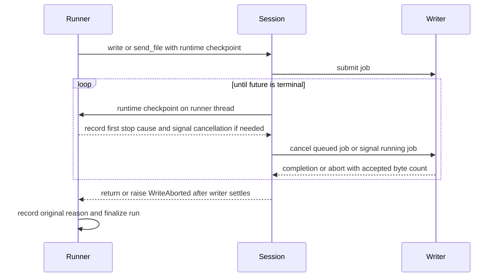

# Script write limits implementation plan

Status: implemented, verified, and archived. The user authorized this roadmap fix after the bounded lines-log change.

## Outcome and design basis

Enforce the existing script deadline and active failure patterns while a write waits, including paced file sends.\
The basis is the runtime checks and first-stop-cause policy in `script/runner.py` at commit `6e92179`, plus the\
existing cancellation polling and terminal-future wait in `script/connection_session.py`. No new execution thread,\
configuration variable, result reason, or estimated write cap is needed. The MCP-only estimated write cap remains\
separate from the script run deadline.

Add an optional runtime checkpoint to `PortSession.write` and `send_file`. The runner supplies a checkpoint that\
records any runtime failure as the first stop cause and sets its existing cancellation event without raising. The\
connection adapter invokes it on the runner thread during its existing 50 ms polling loop. It then cancels a queued\
job or signals a running job and waits for its terminal future. This preserves byte accounting and file-end events\
before the run can finish or its caller release the connection claim. Preserve the existing cancellation and\
failure precedence, including the existing `writer_closed` classification when the writer closes. A regex search\
remains bounded by its own configured limit.

Cancellation still acts between serial segments and interrupts pacing pauses. A serial write or flush already\
blocked in the operating system cannot be forcibly interrupted by this change. Keep ownership until that call\
settles; bounding underlying serial flushes and shutdown cleanup is separate work. File reading also remains a\
synchronous bounded-size operation, rather than a hard wall-clock deadline.

## Execution order and verification

1. Add regressions using the real runner, connection adapter, and serial writer over a fake port. Prove deadline\
   and failure-pattern stops interrupt long paced writes and file sends, prevent later steps, retain partial-byte\
   log counts, and preserve queued-job cancellation and active-job cleanup. Observe the new tests fail first.
2. Extend the internal session protocol and adapter, then connect the runner checkpoint. Update the existing fake\
   session contract. Test cancellation precedence and regex failure behavior; keep pattern checks on the runner\
   thread and wait for the writer before finalization.
3. Update `docs/scripts.md`, tool descriptions and configuration wording where needed, and `CHANGELOG.md`. Remove\
   the completed roadmap item with its verified fix. Run `just check`, the full pytest suite, `just integration`,\
   and changed-file hooks. A fresh correctness and conformance review must find no material mismatch before commit.
4. Archive this ledger, fix its links, and commit it with the verified implementation locally. Do not push or access\
   real serial devices. If a check fails, investigate and fix it within this scope; preserve existing gates.

Apply the repository tests, comments, changelog, plans and roadmap rules. Coding standards, Python style/testing,\
concurrency guidance, test-first implementation, and incremental implementation govern this slice. The existing\
session interface and cancellation mechanism settle the design; a separate design approval is unnecessary. Keep\
shared Git state intact and stage only owned paths.

## Execution record

- Inspected runner runtime checks, session protocol, connection adapter, writer cancellation, and existing tests.
- Implemented the protocol checkpoint, adapter polling, and runner stop-cause handling.
- Plan critique approved the proposed checkpoint, cancellation sequencing, test approach, and retained I/O limits.
- Four real-writer regressions failed on the baseline because deadlines and failure patterns did not interrupt pacing;\
  after the checkpoint implementation, they passed. A separate short-write race regression failed because a detected\
  deadline became serial_error; checking the latched cause before byte-count validation fixed it.
- Added coverage for queued file cancellation, active serial-call settlement, cancellation precedence, end-of-stream\
  and regex timeout.
- Recorded the remaining blocking-I/O boundary in the roadmap; this change deliberately keeps connection ownership\
  until an active serial call settles.
- Initial full gates passed: `just check` (zero errors, 117 existing warnings), 900 tests, and integration.
- Correctness/conformance review found a settlement-exception race that could replace an already detected failure.\
  Eight deterministic write/flush exception regressions reproduced it before correction. The localized fix preserves\
  the stop cause before transport-error classification, retaining existing writer-closure precedence.
- Recorded the pre-existing generic transport-error byte-count gap separately in the roadmap. Cooperative aborts\
  preserve partial counts; this change does not alter the serial writer's error interface.
- Final review approved the code and documentation after the settlement-exception correction. Final static checks\
  passed with zero errors and 117 existing warnings; the full suite passed 908 tests in 31.97 seconds.
- The final integration run failed only the mirror-input log count comparison (4,303 logged bytes versus 4,304\
  expected); received output and script scenarios passed, with no reported admission loss. Earlier integration passed.\
  The harness removed its temporary files, so the missing byte cannot be located from that run. Rechecking with\
  `--keep-work` to retain exact evidence if the mismatch recurs; no cause established and no gate waived.
- The evidence-retaining integration recheck passed every scenario in 91 seconds, including all 4,304 expected\
  mirror-input bytes. The mismatch did not recur; its cause remains unknown and is a separate roadmap defect.
- All changed-file hooks passed. Independent correctness/conformance re-review approved the final code and\
  documentation with no material findings after the settlement-exception fix and wording qualifications.
- Removed the completed in-flight write-limits roadmap item. Remaining blocking I/O, generic-error byte counts, and\
  the intermittent mirror log mismatch are tracked in the roadmap. Archived this ledger with the implementation.
