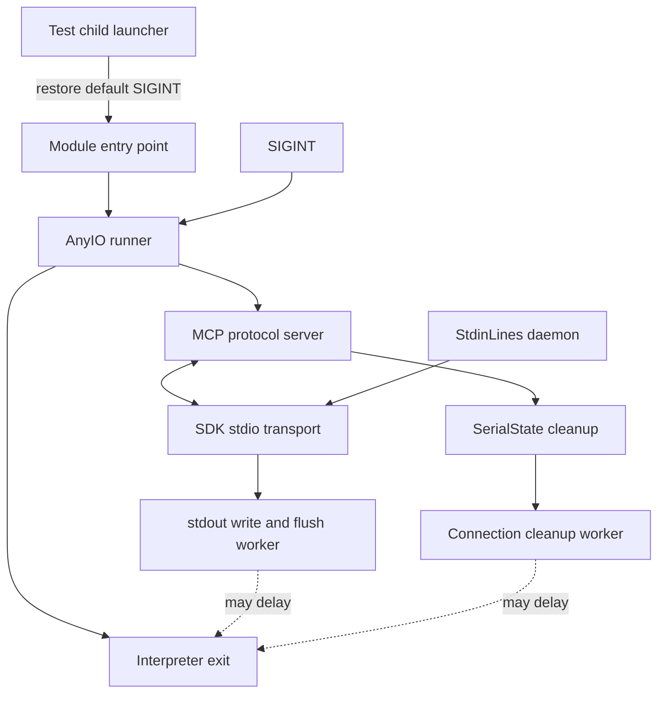

# SIGINT Shutdown Design

Status: implemented, verified, and archived. The accepted test-harness correction is complete.

Basis: the user's request to select and design the next roadmap fix, from `v0.2.3` (`466cde9`). The scope is the Ctrl-C\
shutdown regression. This follows the repository's arc42 design convention. No separate specification governs this\
bounded defect repair; existing behavior supplies the compatibility contract. The user approved the test-only\
correction and did not require historical CI attribution as a closure condition. A separate implementation plan is\
unnecessary: one test module changes, with no production, dependency, data, or rollout changes. This document is the\
implementation ledger.

Decisions and completed work are recorded in sections 9 and 11 below. No device access was needed.

## 1. Introduction and Goals

An MCP client can keep the server's stdin pipe open after sending SIGINT. The server must still exit cleanly after one\
interrupt when its handler is enabled. A historical CI run exceeded the test's five-second deadline. The operator\
should not need to close stdin or send another signal to end an idle server.

The existing regression requires exit status zero and no traceback. Preserve that contract, JSON-RPC framing, and\
normal EOF handling. Five seconds is the regression's existing tolerance, not a new shutdown service guarantee.

The regression previously inherited its launcher's signal disposition. If SIGINT was ignored, the child never requested\
shutdown, so the timeout did not test cancellation. The test now normalizes that precondition, as the CLI tests already\
do.

## 2. Architecture Constraints

Keep production code, dependency ranges, and signal handling unchanged. Do not override an operator's inherited\
ignored-SIGINT disposition in the production entry point. Use AnyIO for project async code.

Production input currently uses a daemon thread and unbuffered descriptor reads. It must remain possible to exit while\
stdin stays open. Do not reintroduce a worker blocked indefinitely in buffered stdin or join that daemon.

Forced process exit, silent abandonment of log output, and a new repeated-interrupt policy require separate decisions.\
This correction introduces none of them. All investigation and verification use subprocess pipes, fakes, or\
pseudo-terminals.

## 3. Context and Scope

The correction belongs to the subprocess launcher in `tests/mcp/test_stdin.py`. It establishes an enabled SIGINT\
handler before entering the real module entry point. The test still observes the complete server process rather than a\
mocked cancellation operation.

The separate roadmap items for an unbounded script cleanup join and worker threads outliving a shutdown deadline are\
adjacent evidence paths. They are not assumed causes of this incident. The failing test opens no serial connection.

## 4. Solution Strategy

The test bootstrap restores `signal.default_int_handler`, then invokes the actual package entry point with\
`runpy.run_module('serial_mcp_server', run_name='__main__', alter_sys=True)`. Retain the interpreter's faulthandler\
flag. Keep the readiness response, open stdin, one SIGINT, and process-exit assertions intact.

Exercise both a normal launcher and one that deliberately ignores SIGINT before executing the test child. Create the\
ignored disposition inside an isolated launcher process; never change pytest's own signal disposition. This verifies\
the bootstrap against the failing precondition without leaking signal state between tests.

Close the roadmap item with the verified test correction, as authorized by the user. If a timeout recurs after\
normalization, capture thread and task-phase evidence to distinguish serving, transport teardown, cleanup, and\
interpreter exit. Do not replace the transport or raise a dependency floor from this reproduced harness defect.

## 5. Building Block View

| Component | Current responsibility and design obligation |
| -- | -- |
| Test child launcher | Bootstrap enables the signal under test before invoking the real module entry point. |
| Server entry point | Loads settings, invokes the AnyIO runner, and treats KeyboardInterrupt as a normal exit. |
| MCP protocol server | Owns request/session task groups; in-flight handlers must unwind when serving stops. |
| SDK stdio transport | Owns stdin and stdout transport tasks; stdout write and flush use AnyIO file operations. |
| StdinLines | Reads descriptor bytes in a daemon thread and delivers complete lines through a memory stream. |
| SerialState cleanup | Cancels scripts and offloads connection shutdown to a worker, abandoning its await on cancellation. |
| Interpreter | Can still wait for non-daemon threads after async shutdown; a returned await is not proof of process exit. |

The test establishes its signal precondition before exercising the existing cancellation scopes:



Only the test child launcher changes. The remaining components describe the existing production control path.

## 6. Runtime View

### 6.1 Existing Interrupt Scenario

The client sends initialize and receives its response, then sends SIGINT while keeping stdin open. Cancellation must\
leave protocol serving and unwind transport tasks. The server's finally block then attempts resource cleanup and closes\
the trace sink. The entry point accepts KeyboardInterrupt, and the process exits without waiting for stdin EOF.

Receiving the response proves that stdout bytes reached the client. It does not prove that the SDK's subsequent flush\
or its initialization handler has completed. The regression therefore exercises a potentially important overlap.

### 6.2 Failure Classification

An ignored signal leaves serving and transport waiting normally for messages. The controlled failure shows no cleanup\
entry, idle memory-stream receive tasks, and an idle worker. Restoring the handler lets shutdown complete.

For a future failure with the signal precondition enabled, use the following classification.

Record whether serving returned, transport teardown completed, cleanup began and ended, and the entry point returned.\
Use test-only phase barriers to hold and release specific operations without changing production scheduling.

If transport tasks remain alive, inspect their awaited operations and cancellation scopes. If the entry point returns\
but the process remains alive, inspect non-daemon worker ownership instead. If cleanup is entered but not left,\
identify its concrete blocking operation. A blocked stdout worker and an uncancelled memory-stream receive need\
different fixes.

Diagnostic output must stay on stderr and contain phase names, thread names, and stack locations only. Do not include\
tool arguments, environment values, serial bytes, or device details.

## 8. Crosscutting Concepts

An AnyIO cancellation deadline bounds an asynchronous wait only when the called operation permits cancellation.\
Abandoning a worker's await does not stop its underlying thread. The server's existing 0.25-second cleanup scope\
therefore cannot establish a process-wide exit bound by itself.

Keep cancellation propagation separate from routine EOF and broken-stream handling. Do not suppress unexpected\
exceptions merely to obtain exit status zero. Preserve the original diagnostic stack when a regression times out.

## 9. Architecture Decisions and Questions

| Question | Recommendation | Status and evidence needed |
| -- | -- | -- |
| What fails reproducibly? | Fix the missing signal precondition in the test launcher. | Confirmed mechanism; actual regression fails under ignored SIGINT and passes with child-only normalization. |
| Did ignored SIGINT cause the historical CI failure? | Do not require attribution to close this correction. | Accepted by user; that run recorded neither signal disposition nor child stacks. |
| Change dependencies or production lifecycle? | Leave both unchanged. | Accepted; failure and successful control occur with AnyIO 4.11.0 and 4.15.1. |
| Override ignored SIGINT in production? | Restore the handler only in the test bootstrap. | Accepted; changing background-process behavior exceeds the demonstrated test defect. |
| Broaden this repair to forced exit or slow cleanup? | Keep those outside this correction. | Accepted; the controlled failure never enters cleanup. |

The proposal can proceed independently of historical attribution because the test's missing precondition is directly\
reproducible. Its load-bearing choice is test-only normalization versus overriding production signal inheritance. The\
correction preserves production behavior. User acceptance is recorded above; historical attribution is not required for\
closure. No unresolved behavior choice remains.

## 10. Quality Requirements

The authoritative regression is\
[`test_the_server_exits_on_sigint_while_its_client_keeps_stdin_open`](../../../tests/mcp/test_stdin.py). It requires\
one SIGINT, open client stdin, exit within five seconds, status zero, and no traceback.

Qualify the eventual correction at the demonstrated signal/transport overlap, with both the lowest supported\
dependencies and the locked dependencies. Preserve line order, split UTF-8 input, EOF delivery, and cancellation of an\
idle input wait. Keep slow cleanup and blocked-output tests separate so a passing idle case cannot hide those gaps.

The ignored-launcher variant must fail with handler restoration removed and pass with it present. Normal-launcher\
coverage must still reach the real module entry point. Bound startup and teardown, retain the faulthandler timeout\
report, and kill and reap every failed test child. Do not add production diagnostic output.

## 11. Evidence, Risks, and Design Ledger

### Evidence Register

The [historical failure](https://github.com/jonatsu/serial-mcp-server/actions/runs/38062908269) used Python 3.11.17,\
AnyIO 4.11.0, and MCP 1.30.0. Its test timed out after SIGINT; 812 other tests passed. It contains no child stack dump.\
The current regression adds faulthandler and requests thread stacks on timeout.

`tests/test_cli.py` already restores the child's default SIGINT handler for its interrupt test. Local Python 3.13.16\
runner source installs its SIGINT cancellation handler only when the current handler is Python's default. The\
controlled probes separately checked ignored and blocked signal state; SIGINT was not blocked.

Repository inspection covers the server entry point, StdinLines, state cleanup, and their current tests. Installed MCP\
1.30.0 source shows the stdio write followed by flush and the protocol server's task-group cancellation. Inspection of\
the AnyIO 4.11.0 implementation does not establish a specific upstream cancellation defect.

An isolated local baseline with Python 3.13.16, AnyIO 4.11.0, and MCP 1.30.0 passed all four stdin tests. This is not a\
reproduction of the historical Python 3.11 environment. Python 3.11 is unavailable under the shell's system-only\
interpreter policy; that policy was preserved. The published release's lowest-dependency CI job also passed, so the\
existing diagnostic has not supplied a fresh failing stack.

### Controlled Reproduction

The unchanged MCP shutdown regression fails when its parent inherits ignored SIGINT. It times out after five seconds\
and reports one failure in 5.29 seconds. Core dumps were disabled for this diagnostic run; no hardware opened.

Changing only the diagnostic child launcher to restore the handler makes all four stdin tests pass in 2.52 seconds with\
locked AnyIO. The minimum-AnyIO control passes all four in 3.12 seconds. These controls patch the launcher in memory;\
neither production files nor test files were edited.

Instrumented normal and restored-handler servers exit zero in approximately 64 ms with both AnyIO versions. Ignored\
handlers exceed five seconds without entering cleanup. Async task snapshots show protocol and transport awaiting\
memory-stream input; the worker is idle, and the daemon stdin reader awaits bytes. This establishes the controlled\
failure's cause but cannot recover the historical CI process's signal disposition.

At investigation revision `498a425`, this command reproduced the missing signal precondition without editing files.\
After the correction it passes, including when pytest itself inherits ignored SIGINT:

```bash
uv run --no-sync python -B - <<'PY'
import resource
import signal
import pytest

resource.setrlimit(resource.RLIMIT_CORE, (0, 0))
signal.signal(signal.SIGINT, signal.SIG_IGN)
raise SystemExit(pytest.main([
    'tests/mcp/test_stdin.py::test_the_server_exits_on_sigint_while_its_client_keeps_stdin_open',
    '-q', '--tb=short',
]))
PY
```

This command changes signals only inside its diagnostic process.

### Design Ledger

| Work | State | Next action or result |
| -- | -- | -- |
| Release publication | Complete | v0.2.3 release, notes, wheel, and source archive verified; release CI, main CI, and CodeQL succeeded. |
| Prioritize next defect | Complete | Select Ctrl-C exit reliability; rendering qualification still needs additional setup and authorization. |
| Read incident and lifecycle | Complete | Historical timeout confirmed; component boundaries identified; cause remains unknown. |
| Focused floor-dependency baseline | Recorded limitation | Four tests passed on available Python; exact historical Python environment remains unqualified locally and is not required for this closure. |
| Checkpoint validation | Complete | Checks, hooks, and all 878 tests pass. |
| Commit signing | User approval required | The Bitwarden SSH agent requires approval at the laptop; retry a refused signature when the user is available, keeping signing enabled. |
| Reproduce signal-inheritance failure | Complete | Actual regression fails under ignored SIGINT; phase and task evidence locate the missing shutdown request. |
| Test candidate normalization | Complete | In-memory launcher control passes all four stdin tests with both locked and minimum AnyIO. |
| Historical CI attribution | Not required for closure | User accepted closing this item with the verified correction; the old process's disposition was not captured. |
| Settle correction and compatibility | Accepted | Normalize the test child only; retain production behavior and dependency requirements. |
| User acceptance and implementation scope | Approved | User authorized the correction; one test module and its records need no separate plan. |
| Implement and verify the regression | Complete | New ignored-launcher test failed in 5.29 s before restoration; all five stdin tests pass with locked and minimum AnyIO. |
| Final verification and closure | Complete | 879 tests and required checks pass; independent correctness/conformance review approves; roadmap and changelog updated; ledger archived. |

## Implementation and Closure

The implementation surface is the subprocess regression in `tests/mcp/test_stdin.py`, with an isolated ignored-signal\
launcher and explicit child bootstrap. Existing CLI test behavior supplies a precedent, not a reason to couple\
unrelated fixtures. Preserve the actual package entry point and diagnostic flags.

The added ignored-launcher case failed before signal restoration and passes afterward. Initialization now has a bounded\
read, and cleanup closes all pipes and reaps the child. The full-suite and review evidence below governs closure. The\
remaining slow-cleanup roadmap items stay outside this correction.

Final verification: all 879 tests pass in 29.74 seconds. `just check` passes with zero errors and 117 existing\
warnings, down from 123 after narrowing the changed test's pipes. Five focused tests pass with locked AnyIO in 2.84\
seconds. The same five pass in 3.18 seconds with AnyIO 4.11.0 while pytest itself ignores SIGINT. The new\
ignored-launcher case failed at the expected five-second timeout before handler restoration, then passed afterward.

The independent correctness and conformance reviewer approved the implementation with no material findings. Review\
covered signal isolation, the real entry point, bounded startup, process and pipe cleanup, preserved assertions,\
unchanged production behavior, archive links, and the accepted closure scope. The reviewer inspected code and evidence\
but did not rerun tests. There is no separate specification; historical CI attribution is not a closure condition.

The integration harness was not rerun for this test-only change: no production port, log, script, or stdio handling\
changed. No new package, environment setting, hardware access, or deployment step was introduced.
