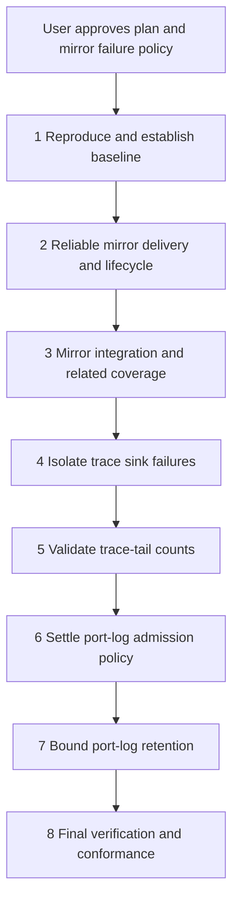

# Mirror Reliability Implementation Plan

Status: approved; implementation in progress on `feat/mirror-reliability`.

Basis: repository revision `7eeb44a5ddf03c2d0f018d3c911904e82e9fd9b7` and the user's approved proposal direction. This\
document combines the bounded proposal, remaining behavior decisions, implementation order, and execution ledger.\
The user approved implementation and the 1 MiB fail-on-overflow policy after the plan-critic review.

## Outcome and Scope

Preserve mirrored serial bytes during normal operation and temporary terminal backpressure. Report a mirror failure\
explicitly when delivery cannot continue. Preserve CR, LF, CRLF, and terminal escape sequences without conversion.\
External terminal programs own rendering, wrapping, local echo, and their own terminal settings.

Then address the selected [roadmap](../roadmap.md) items in this order: trace file failures, invalid trace-tail counts,\
and the port-log admission memory bound. Include the mirror forwarding-failure warning and post-configuration pacing\
test gaps with mirror work. Leave unrelated roadmap items in place.

The observed wrapping defect remains unconfirmed. Local Linux probes preserved CR/LF and escape bytes through the\
actual mirror in both directions. A separate burst probe delivered only 11,776 of 100,013 bytes to the mirror, losing\
its trailing CRLFs; the MCP buffer retained every byte. Existing mirror tests passed, but do not establish correct\
rendering in the affected external CLI.

## Proposed Behavior and Approval Decisions

### Mirror Delivery

Use the existing reader thread to maintain an ordered output queue and poll the PTY master for writability. A\
pseudo-terminal (PTY) connects the server's master endpoint to the external CLI's slave endpoint. Retain the unwritten\
tail after a partial write or temporary blocking. Drain a bounded amount per loop iteration so output cannot starve\
serial reception or mirror input. Bound both queued bytes and queued objects, for example through coalesced chunks.

Approved limit: 1 MiB of pending output per connection. On overflow or an unrecoverable PTY error, fail the mirror,\
stop accepting its input, close both PTY descriptors, and remove its symlink. Keep the serial reader, MCP buffer,\
writer, scripts, and port log running. Remove failed descriptors from every select set. Already-submitted mirror writes\
retain their existing writer semantics; failure prevents new submissions.

Keep failed mirror metadata available through `mirror_info()`, as reported by connection status and introspection.\
Preserve existing `pty_path`, `link`, and `mode` fields; add `state`, `failure_reason`, `pending_bytes`, and\
`undelivered_bytes`. A failed path is historical, not attachable. Count application-queued output discarded at failure\
and the triggering chunk; kernel-buffered delivery cannot be measured reliably. Explain this coverage limit. Emit one\
warning per failure, without serial payloads.

Recovery uses the existing `serial.close` and `serial.open` operations. This interrupts the serial connection and\
requires stopping a running script first. Do not add a mirror-restart tool in this change. A viewer that never attaches\
can exhaust the limit too, because the server keeps the slave endpoint open. This is a deliberate consequence of the\
proposed fail-on-overflow policy.

The user approved failure at the bounded limit, including with no viewer attached. Failure prevents an interactive\
session continuing with silently corrupted output. Counted gaps preserve availability but cannot promise an intact\
display. Unbounded buffering risks process memory; blocking the serial reader risks device-side receive loss. Disk\
spooling adds storage failure and retention design, so it is outside this plan.

Required raw-mode initialization must fail mirror construction on error and release descriptors, symlinks, and any\
factory-allocated index. Baud reporting remains best effort. Initialization and runtime failure are distinct:\
construction fails the open request, while a runtime mirror failure leaves the serial connection usable.

### Trace Reliability

A runtime trace file write or flush failure disables that file sink, retains in-memory events, emits one warning, and\
does not change a tool's result. Report the sink state and sanitized failure reason through `serial.trace.status`.\
Guard cleanup errors so shutdown does not raise another sink exception. Preserve existing startup failure behavior; do\
not expand this into trace rotation or asynchronous trace I/O.

Proposed trace-tail contract: zero returns an empty list, negative counts return `invalid_params`, and positive counts\
retain current behavior. Preserve integer-string support and validate counts even when tracing is disabled. Approval of\
this plan accepts that contract; update the tool's property description with it.

### Port-Log Admission Retention

The current 8 MiB cap counts payload bytes only. Queue entries, event dictionaries, and overflow markers also consume\
memory. Add an entry-count limit and a bounded charge for retained metadata, retaining the existing payload-byte cap.\
Account for the entry being processed as well as pending entries, and aggregate overflow evidence outside the queue so\
reporting does not create another unbounded stream.

This bounds admission retention, including the current disk-thread entry, rather than all memory used by logging.\
Format-owned buffers are separate: `LinesWriter` can retain a continuously growing unfinished line. Its size-triggered\
partial-line emission needs a separate behavior design, recorded in the roadmap. Do not claim this plan fixes that\
format-buffer limit or add forced partial emission to unit 7.

This unit starts with a design checkpoint. Determine conservative limits and metadata accounting from `Entry` and real\
producers. Large marker labels require a metadata bound; an entry-count cap alone is insufficient. Do not claim an\
exact resident-memory cap from serialized byte counts.

Preserve existing counted payload-drop behavior where possible. Configuration events change how later records are\
decoded, so dropping an arbitrary event can corrupt interpretation. Recommend stopping log admission with an explicit\
failure if a required control event cannot be retained, while keeping device I/O running. Settle the exact event policy\
and public counters before coding this unit. Return any unresolved behavior choice to the user; earlier units can\
proceed independently once approved.

## Order and Dependencies



Mirror units depend on the failure-policy decision. The trace units have no runtime dependency on the mirror; their\
position keeps the reported defect first. The port-log design checkpoint precedes its implementation because losing\
control events changes log meaning.

## Shared Working Rules

Keep planning, review corrections, and every implementation unit on `feat/mirror-reliability`. Do not create branches\
per change. Use separate commits for independently verified outcomes. Preserve the shell's configured `UV_CACHE_DIR`\
and other tooling settings. Investigate sandbox failures and request tool-level escalation where required instead of\
replacing those settings.

Before editing, follow [AGENTS.md](../../AGENTS.md), [CONTRIBUTING.md](../../CONTRIBUTING.md), and matching\
`.agents/rules/` files. Load `coding-standards`, the relevant Python skills, and `test-driven-development` for focused\
regressions. Load `writing-documentation` and `writing-for-humans` for documentation. Use language-server references\
before changing a symbol's contract, confirmed by text searches for string-based patch targets. Keep imports within the\
configured package layers and environment reads in `config.py`.

Use only fake ports and pseudo-terminals. Never open a real serial device. Run the repository checks before each commit:

```bash
just check
uv run --extra test python -m pytest tests -q
```

Run `just integration` after changing `port/`, `portlog/`, or the integration harness. Run pre-commit on the explicit\
changed paths. Watch new regression tests fail before implementing their fix, then pass afterward. Record failures\
honestly; repair local in-scope defects without bypassing hooks or weakening checks.

Update this ledger with revisions, evidence, findings, and deviations as each unit lands. Update affected behavior\
documentation, tool descriptions and property descriptions, and `CHANGELOG.md` under `Unreleased` in the same behavior\
commit. Keep planned roadmap entries linked to their units until verified fixes land. Remove only completed items\
with their changelog entries; retain unrelated indirect-coverage items.

The implementer reviews every diff. An independent code reviewer reviews substantive behavior units before dependent\
work proceeds. Small trace-tail validation may use self-review plus focused behavioral tests. Final integration\
includes an independent code review and a separate `conformance-review` against this plan. Assign reviewers before\
their gates; a missing reviewer keeps that gate open. Resolve blocking findings and recheck changed evidence before\
closing a unit.

## Unit 1: Reproduction and Baseline

Inspect `serial_mcp_server/port/mirror.py`, `port/reader.py`, `port/writer.py`, and `port/stack.py`, plus\
`tests/port/test_mirror.py`. Reproduce loss with an exact byte oracle and a slow PTY reader. Cover CR, LF, CRLF split\
across chunks, escape sequences, and long multiline input in both directions. Use events or readiness polling rather\
than timing guesses.

Obtain the affected external CLI command, configuration, and device shell when available. Compare device bytes, the MCP\
receive stream, and mirrored bytes with matched settings. If bytes match but wrapping differs, inspect CLI wrap and\
newline settings; do not compensate by rewriting serial bytes. Preserve the wrapping issue as unresolved when the\
affected setup is unavailable.

Run the shared checks and `just integration` for a baseline. Completion requires a regression that fails for the\
demonstrated output-loss defect and a record separating proven transport behavior from rendering hypotheses. The\
original wrapping report is not closed without a reproduction and passing evidence, or the user's confirmation.

Keep a failing regression local until unit 2 supplies its fix. Commit it together with the passing implementation;\
unit 1 is an evidence checkpoint, not a commit that leaves the suite red.

## Unit 2: Reliable Mirror Delivery and Lifecycle

Change `MirrorSession` in `serial_mcp_server/port/mirror.py` to queue received output, drain on writability, and retain\
partial writes. Continue delivering bytes to the MCP buffer, log, and subscribers regardless of mirror state. Keep\
runtime mirror failure distinct from reader failure. Audit `_run`, `_read_fds`, `_on_data`, `mirror_info`, and resource\
release together.

Repair construction cleanup in `MirrorSession` and `create_reader`, including raw-mode failure and index allocation.\
Review `port/stack.py` cleanup to ensure a failed mirror open does not leak the writer or log. Define thread-safe\
metadata snapshots for status consumers in `mcp/tools/connection.py` and `mcp/tools/introspection.py`.

Extend `tests/port/test_mirror.py` and relevant connection tests. Inject short writes, temporary blocking,\
unrecoverable errors, raw-mode failures, and overflow. Prove ordered eventual delivery after a temporary stall, bounded\
retention, no busy loop when idle, continued MCP reception after mirror failure, stopped input admission, and\
idempotent resource cleanup. Test normal close with pending output without extending existing shutdown waits\
indefinitely. Record queued output abandoned on close distinctly from overflow failure.

Update `docs/concepts.md`, applicable `docs/tools.md` text, tool descriptions, and the changelog. Complete this unit\
only after shared checks, integration, and independent review pass. Fix reader termination or leaked resources before\
continuing; do not recover by blocking the serial reader.

## Unit 3: Integration and Adjacent Mirror Coverage

Extend `tests/integration/harness.py` and `tests/integration/run.py` to retain an exact mirror-byte oracle instead of\
only recording its length. Wait for expected delivery before closing the terminal. Exercise a controlled slow reader,\
long multiline commands, split CRLF, and concurrent MCP reads. Verify overflow separately from a recoverable stall.

Inventory existing tests before adding the roadmap's forwarding-failure warning and post-`serial.configure`\
mirror-pacing checks. `tests/mcp/tools/test_connection.py` already contains\
`test_chunk_pacing_applies_to_the_next_mirror_forward`; confirm its exact coverage and retain it if sufficient. Add\
only missing behavior, including successful pacing updates and warning behavior for a failed forwarded write.

Run a local Minicom smoke test over disposable PTYs with explicit wrapping and newline settings if its environment\
permits. Record what it proves and whether it reproduces the reported setup. Shared checks and `just integration` must\
pass. Completion requires exact mirrored bytes, responsive MCP reads, and direct evidence for both selected roadmap\
gaps.

## Unit 4: Trace File Failure Isolation

Change `TraceBuffer.emit`, status, and cleanup in `serial_mcp_server/mcp/trace.py`. Detach the failed sink before\
closing it so a cleanup exception cannot restore or repeat the failure. Preserve memory events and the normal tool\
result. Extend `mcp/tools/trace.py` descriptions and `docs/tools.md` for sink health.

Extend `tests/mcp/test_trace.py` with write, flush, and close failures and calls after failure. Exercise the dispatcher\
in `tests/mcp/test_server.py`: a trace-start failure must not prevent the handler from running, and a trace-end failure\
must not replace a successful or failed handler result. Expect one sink warning and accurate status without payload\
disclosure.

Run shared checks and independent review. Completion requires passing dispatcher-level evidence and a changelog entry.\
Sink initialization failures and file rotation remain outside this unit.

## Unit 5: Trace-Tail Validation

Validate `n` in `serial_mcp_server/mcp/tools/trace.py`, before the tracing-disabled return. Make `TraceBuffer.tail(0)`\
return no events and reject negative counts at its own boundary too. Preserve valid positive integer strings and\
defaults. Update the tool property description and `docs/tools.md`.

Extend `tests/mcp/test_trace.py` for zero, negative, invalid strings, default, positive, and counts larger than the\
ring, with tracing enabled and disabled. Verify negative values become the existing `invalid_params` response through\
the dispatcher. Shared checks, self-review, and a changelog entry close this small unit.

## Unit 6: Port-Log Admission Design Checkpoint

Inspect `serial_mcp_server/portlog/log.py`, `portlog/formats.py`, `mcp/tools/log.py`, and the event producers. Specify\
entry limits, metadata charging, aggregation, and required control events. Bound zero-payload events, many tiny writes,\
and one oversized marker. Include the current disk-thread entry and shutdown markers in the accounting.

Record the proposed constants, counters, saturation behavior, and recovery here. Have the user settle any new\
consequential choice before unit 7; do not silently drop decoding configuration. This checkpoint is complete when the\
admission contract is concrete enough for regression tests and its behavior is accepted.

## Unit 7: Bound Port-Log Admission Retention

Implement the accepted admission contract in `serial_mcp_server/portlog/log.py` and `portlog/formats.py`. Update\
`mcp/tools/log.py` status and stop responses together so both report complete loss or failure information. Preserve\
existing payload counters and byte-exact raw output for admitted data. Keep reader and writer submissions nonblocking.

Extend `tests/portlog/test_log.py`, `tests/portlog/test_formats.py`, and `tests/mcp/tools/test_log.py`. Stall the disk\
deterministically, submit tiny payloads, event-only traffic, oversized fields, and configuration changes. Assert\
bounded retained entries and charged bytes, exact counters, correct marker ordering, and safe close under saturation.\
Confirm recorded data uses the correct decoding configuration.

Update `docs/concepts.md`, `docs/tools.md`, tool descriptions, and the changelog. Shared checks, `just integration`,\
and independent review close the unit. Keep rotation, default directories, and unrelated log failure behavior outside\
its scope.

## Unit 8: Final Verification and Closure

Run shared checks and `just integration` on the combined tree. Review CR/LF preservation, delivery recovery, overflow\
isolation, trace result preservation, trace-tail validation, and port-log admission retention against this plan. Obtain\
final code review and a separate conformance review with the base and head revisions, this plan, and recorded evidence.

Resolve blocking findings and record limits of any external-CLI smoke test. Do not mark the original wrapping issue\
fixed solely because byte-level tests pass. Update every affected ledger. When all units are complete, move this plan\
to `docs/plans/archive/` and repair links in one closing commit. Return unresolved work to the roadmap with concrete\
evidence and next action.

## Execution Record

| Work | Status | Evidence or next action |
| -- | -- | -- |
| Planning and roadmap links | Committed | `82e81ce`: initial plan and roadmap ownership; review corrections follow. |
| Plan-critic review | Complete | Both findings corrected and rechecked; verdict: proceed, subject to user approval. |
| User approval | Approved | Implementation and the 1 MiB fail-on-overflow policy; port-log policy retains its later checkpoint. |
| Reproduction and baseline | Complete | Baseline integration passed all eight groups; short-write and EAGAIN regressions failed before the fix. |
| Reliable mirror delivery | Complete | 25 mirror tests, 822 full-suite tests, zero check errors, all integration groups pass; independent reviewer approved. |
| Mirror integration coverage | Complete | Slow-viewer and overflow scenarios, 823 tests, zero check errors, full integration, and review pass. |
| Trace sink isolation | Complete | 43 focused tests, 833 full tests, checks, and independent review pass. |
| Trace-tail validation | Not started | Unit 5. |
| Port-log admission design | Approved | User accepted the bounded admission contract and failure policy below. |
| Port-log admission retention | Not started | Unit 7. Format-owned partial-line buffering stays on the roadmap. |
| Final verification | Not started | Unit 8. |

Planning corrections: use only `feat/mirror-reliability` for this work, and preserve the configured shell environment.\
The sandbox restricted the configured uv cache earlier; escalate required tooling instead of overriding `UV_CACHE_DIR`.

Planning validation: `just check` passed with zero errors and the existing 123 type-checker warnings. The full suite\
passed outside the sandbox: 813 tests in 29.27 seconds, with `faulthandler_timeout=60` for stall diagnostics.\
Pre-commit passed on both planning documents. The earlier sandboxed test run stalled after 69 tests and was\
interrupted; its result is not a passing baseline. Integration has not run for these documentation-only changes.

Review of `82e81ce`: the critic found the mirror and trace mechanisms feasible. Its first finding identified\
`LinesWriter._feed` retaining unfinished lines outside the admission queue. The plan now names its limited scope, and\
the roadmap records a separate partial-line bound. Its second finding identified removal of unfinished roadmap entries\
contrary to `.agents/rules/plans.md`. Those entries are restored with plan links, and the roadmap's opening now matches\
the scoped rule. Both corrections change documentation only. Unit 1 also explicitly keeps its failing regression\
uncommitted until unit 2 passes. Mirror overflow and the later port-log admission policy remain user decisions.

The critic rechecked the corrections and found both findings addressed, with no new contradiction or broken link.\
Pre-commit passed on the corrected documents. No production code or tests changed, so the planning check and full-suite\
evidence above remains applicable. The user subsequently approved starting implementation and the mirror overflow\
policy.

Units 1 and 2: test-first failures delivered only `lon` after a short write and no bytes after temporary blocking.\
The implementation retains coalesced chunks and retries writable PTYs; nine new tests pass, including a real\
100,013-byte burst, bidirectional newline/escape preservation, overflow isolation, read/write failures, pending-close\
accounting, descriptor reuse, and raw-init cleanup. The expanded mirror suite passes 25 tests; the full suite passes\
822 tests in 29.08 seconds. `just check` reports zero errors and the existing 123 warnings. Integration passed all\
eight groups in 89 seconds. Independent correctness review approved the unit without findings. The output-loss\
roadmap defect is removed with its changelog entry; the original external-CLI wrapping report remains unconfirmed.

Unit 3: focused real-process scenarios preserve 100 KiB of long multiline output through a paused then slow viewer,\
and isolate an unattached viewer's overflow during 1.3 MiB of output. Device, mirror, MCP, and raw-log byte oracles\
agree. Actual PTY forwarding follows a post-configuration 512-byte chunk limit. The forwarding-failure warning\
regression passes. The full suite passes 823 tests in 29.24 seconds; checks report zero errors and 123 warnings.\
Independent test correctness review approved the changes. Full integration passed all groups, including the new\
slow-viewer and overflow scenarios. Both selected mirror coverage gaps are removed from the roadmap with this commit.

A disposable-PTY Minicom smoke used `-o -w -8 -b 115200 -t xterm`. Its emitted display instructions moved the long\
line to rows 10 and 11, and displayed the following line separately; Minicom exited zero. Its capture file was not\
used as a byte oracle. The first smoke timed out during interactive exit; the retry handled the exit confirmation\
and bounded cleanup. This verifies the tested wrapping configuration, not the user's still-unspecified shell setup.

### Approved Port-Log Admission Contract for Unit 6

Read-only inspection confirmed that `_put` charges only payload bytes, `_run` releases their charge before writers\
finish, and events and overflow markers have no entry budget. `_Decoder.follow` changes later decoding when a\
`configure` event carries `encoding`; losing that event while accepting later data is unsafe. User-controlled mark\
labels and newline strings can make metadata large. `TestOverflow` currently excludes the in-flight entry, so its\
expectations must change with the proposed retained-payload contract.

Recommend retaining the existing 8 MiB payload limit and adding limits of 4,096 ordinary retained entries and 1 MiB\
of retained metadata. Include the in-flight entry until every format writer finishes with it. Limit one immutable\
metadata snapshot to 64 KiB, depth four, and 128 values. Snapshot supported primitive structures before retaining\
them; reject unsupported or oversized entries rather than truncate log facts. These bounds constrain admission\
retention and do not claim exact Python heap usage or bound format-owned partial-line buffers.

Under pressure, drop a new data entry or observational event whole and aggregate its loss outside the queue. Keep\
`dropped_bytes`; add `dropped_entries` and `dropped_events`. Reserve bounded bookkeeping for a loss marker and a\
terminal failure so reporting cannot grow the queue without limit. Emit loss evidence before the next admitted\
entry, or during shutdown. A rejected decoding-sensitive configuration event stops further log admission, drains\
the accepted prefix, emits one warning, and exposes `admission_error`. Device I/O remains usable. Recovery is\
`serial.log.stop` followed by `serial.log.start` on the same connection; it does not reopen the serial port.

This changes the former guarantee that events are never dropped and charges in-flight payload against the existing\
cap. The user approved these limits and the complete policy through the decision prompt. Unit 7 may implement it\
after the trace units land. No further approval is needed for this accepted contract.

Unit 4: eight new tests failed before the trace sink fix. Runtime write, flush, and close failures now disable file\
output while retaining memory events and successful or rejected dispatcher results. `file_state` and sanitized\
`file_error` expose health; the original error remains sticky if cleanup also fails. The focused suite passes 43\
tests; the full suite passes 833 in 29.19 seconds. Checks report zero errors and 123 existing warnings. Independent\
correctness review approved without findings. The trace-sink roadmap defect is removed with its changelog entry.
