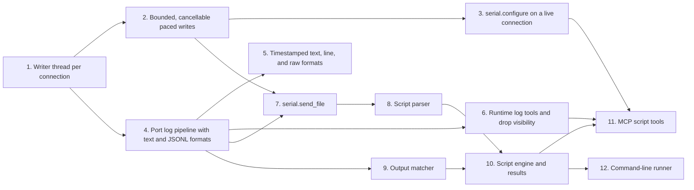
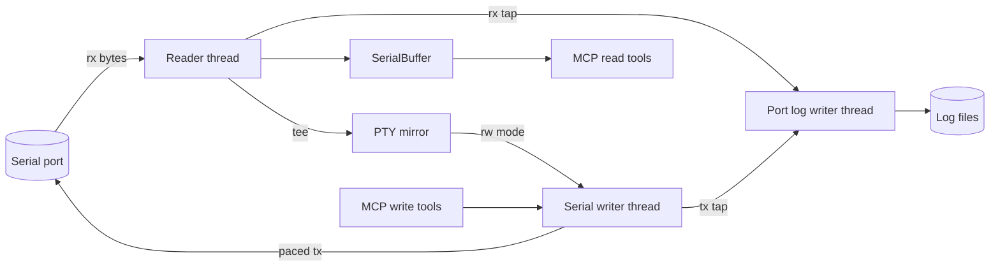

# Write Pacing, Port Logging, and Script Input Implementation Plan

Status: proposed. No implementation has run.
Basis: `main` at `bceb725` (feat(mcp): require SDK 1.30 and annotate tools), the pacing review of commits `690b8a6`
and `fcf1d72`, the decisions recorded in [Design Basis](#design-basis), and the
[script runner design](script-runner-design.md) for units 8 to 12.
Execution record: [Execution Record](#execution-record) at the end of this plan; the repository has no other tracker.

## Implementation Overview

This plan delivers three capabilities in order. Write pacing never stalls the receive path. A port log records the
bytes the port sends and receives, and marks any gap. File input feeds a device from text files for automated
tests. Each capability depends on the one before it. The port log records transmitted bytes where they leave the
host. That single exit point exists only after the pacing work moves all writes onto one writer thread. File input
and scripts then write through that writer and record into the port log, so a test run reads back step by step.

The pacing work comes first because it fixes a defect. In read/write mirror mode, the thread that reads the port
also forwards data typed into the mirror terminal, and it now paces that forwarding. A 4 KiB paste at 8 ms per
character keeps that thread away from the port for about 33 seconds, so device output can overflow the kernel
buffer and be lost.



Units 4 to 6 could run beside units 2 and 3 once unit 1 lands. Sequential ownership is still the default, because
units 2, 4, and 6 all edit `serial_mcp_server/handlers_serial.py` and the connection dataclass in
`serial_mcp_server/state.py`.

The data flow after units 1 and 4 looks like this:



## Design Basis

No separate design document exists. The decisions below come from the review of the pacing commits and the
user's direction on that review, and they govern units 1 to 7. The script runner design governs units 8 to 12.

### Pacing

All transmitted bytes go through one writer thread per connection. The reader thread never writes to the port,
so pacing cannot delay receiving. A second, mirror-only forwarding thread was rejected. It would leave two writers
that still share a lock, and the port log would need two transmit taps.

A paced write is bounded and cancellable. Its estimated duration, the number of segments times the delay, must
not exceed a server-wide cap. Cancelling the MCP request or closing the connection stops the write between
segments. A write that fails partway reports how many bytes the host accepted before the failure.

The public pacing parameters stay as they are. Inside the writer, character pacing becomes chunk pacing with a
chunk size of 1, which removes one code path without changing any tool schema.

### Port log

The port log is a per-connection recording of the bytes on the wire, separate from the existing tool-call trace in
`serial_mcp_server/trace.py`. This plan says "port log" throughout to keep it apart from that trace and from the
Python `logging` output on stderr.

Port logging is off by default, so a server started without new options behaves as it does today. It can be
enabled in two places, and the more specific one wins:

1. Arguments on `serial.open` or `serial.log.start` control one connection. When the user asks the agent to log
   the session, the agent uses these arguments, and the tool descriptions tell it to do so.
2. Environment variables set in the MCP client configuration (the `env` block, or `claude mcp add -e`) set the
   default for every connection.

Every other server option in this repository is an environment variable, as in `serial_mcp_server/helpers.py`, so
launch options follow that convention. Command-line flags were rejected because the server has no argument parser
and MCP client configurations already pass environment variables.

When logging is enabled without a format, the format is `text`. The agent may choose any combination of these
formats:

| Format  | Extension     | Content                                                                                    |
| ------- | ------------- | ------------------------------------------------------------------------------------------ |
| `text`  | `txt`         | Received bytes written unchanged, so lines split where the device sent newlines. Default.  |
| `jsonl` | `jsonl`       | One JSON object per received or transmitted chunk, plus control events.                    |
| `lines` | `lines.jsonl` | One JSON object per newline-terminated line, in each direction, with the line's timestamp. |
| `raw`   | `bin`         | Received bytes only, byte-exact, for replay and binary diffing.                            |

The `text` format has an optional timestamp prefix in the style of `grabserial`, a serial capture tool by Tim Bird.
With its `-t` option, grabserial prefixes each received line with `[elapsed delta] `. The first number counts
seconds since the first received byte, and the second counts seconds since the previous line, both to six decimal
places. Grabserial stamps a line when the line's first byte arrives ([grabserial source](https://github.com/tbird20d/grabserial/blob/master/grabserial)). The port
log offers `elapsed` for that form and `system` for wall-clock time in place of the elapsed time. The default is
no prefix, so the `text` file holds exactly the newline-split received text.

Each log is named for the local time it starts, as `serial-mcp-log-<DDMMYYYY>-<HHMM>.<extension>`. A log started
at 14:05 on 8 October 2026 in the default format writes `serial-mcp-log-08102026-1405.txt`. When a file with that
name exists, the name gets a running number, `-1`, `-2`, and so on: `serial-mcp-log-08102026-1405-1.txt`. All
formats of one log share the same base name and number, so their files sort together. A log never rotates;
it ends when the connection closes or `serial.log.stop` runs, and the next log gets a new name.

The agent never chooses a log directory or file name, only whether to log and in which formats. Files go under one
operator-controlled directory, which keeps an agent from writing to arbitrary paths. The file name does not carry
the port; `serial.open` and `serial.log.status` return each connection's log paths, and the `jsonl` format's
`open` event records the port and its configuration.

### File input

`serial.send_file` streams a file's bytes to the port with the connection's pacing. It reads only from one
operator-controlled directory, because a free path would let an agent send any readable file, such as an SSH key,
out over the serial line.

The script runner interprets a text file as a sequence of commands and expectations. Its
[design](script-runner-design.md) governs units 8 to 12.

## Shared Preflight

### P1: Environment and Baseline

Work on a branch named for the unit, such as `fix/serial-writer-thread`, as the global Git rules require. Install
the test extra and run the baseline once:

```bash
uv run --extra test python -m pytest tests/ -q
uv run --with ruff ruff check .
uv run --with ruff ruff format --check .
uv run --with bandit bandit -r serial_mcp_server/ -c pyproject.toml
```

These are the checks the CI workflow in `.github/workflows/cicd.yml` runs. The baseline at `bceb725` is 243
passing tests. Record any other result in the execution record before editing.
`uv.lock` is ignored by `.gitignore`, so `uv run` leaves the tree clean.

All tests must run without serial hardware. Follow the existing pattern in `tests/conftest.py`: `MagicMock` stands
in for `pyserial.Serial`, `tmp_path` isolates files, and `monkeypatch` sets environment variables. PTY tests in
`tests/test_mirror.py` use real pseudo-terminals and run on Linux and macOS only.

### P2: Guidance

Load these skills before editing the matching work, and show compliance in the review evidence:

- `coding-standards` and `python-style` for every code change.
- `python-async-patterns` for thread, future, and cancellation work (units 1, 2, 4, 7).
- `python-error-handling` for configuration parsing and failure reporting (units 2, 4, 7).
- `python-testing` for all new tests; `test-driven-development` where a focused test can state the behavior first.
- `security-review` for units that accept paths or create files (units 4 and 7).
- `writing-documentation` for `docs/tools.md`, `docs/concepts.md`, `README.md`, and `CHANGELOG.md` changes.

Follow `CONTRIBUTING.md` for tool registration: each tool is a `Tool` in a `handlers_*.py` `TOOLS` list with an
`async def handle_x(state, args)` handler in that file's `HANDLERS` map, named `serial.<action>` or
`serial.<category>.<action>`. Handlers return `_ok(...)` or `_err(code, message)` from
`serial_mcp_server/helpers.py`. Accept string-typed numbers and booleans as the existing schemas do, since some
MCP clients send every argument as a string. Set `ToolAnnotations` on every new tool, as commit `bceb725` did for
the existing ones.

### P3: Documentation and Change Log

Each unit that changes a tool, an environment variable, or observable behavior updates `docs/tools.md`, the
environment variable table in `README.md`, and an `## Unreleased` section at the top of `CHANGELOG.md` in the
existing Added and Fixed style. Architecture changes also update `docs/concepts.md`.

### P4: Review and Commit Gate

The implementer runs the P1 commands, reviews the diff, and records the observed results. A `code-reviewer`
subagent then reviews the exact diff and test evidence before dependent work begins, with a `clean-code-reviewer`
pass alongside it. Dispatch `code-reviewer` with `model: opus` for units 1, 2, and 4, which change thread
concurrency, and for unit 7, which crosses a file-access trust boundary. The implementer fixes findings, and the
reviewer rechecks only the changed findings and affected evidence. Blocking findings close before the commit.

Commit each unit as one Conventional Commit on its branch with an explicit pathspec. Pushing and merging need the
user's authorization.

## Unit 1: Writer Thread per Connection

### Outcome and Rationale

Every byte sent to the port, whether from `serial.write` or from a mirror terminal in read/write mode, goes
through one writer thread per connection. The reader thread only reads, so a long paced write no longer delays
receiving or the mirror's output (Design Basis, Pacing).

### Changes

Add a `SerialWriter` class in a new module, `serial_mcp_server/writer.py`. It owns one daemon thread, a FIFO of
write jobs, and the connection's default pacing as a frozen `Pacing` value. The writer is the only owner of that
default; `SerialConnection` and `_conn_config` read it from the writer rather than keeping copies.

`submit()` takes a payload, an optional pacing override, and a source label (`mcp` or `mirror`). It returns a
`WriteJob` handle that holds a `concurrent.futures.Future`, which resolves to the number of bytes written, and a
cancel event that unit 2 uses. Before running a job, the thread calls `future.set_running_or_notify_cancel()` and
skips the job when that returns false. Without that call, a job cancelled while queued would still write its bytes,
and the later `set_result` would raise `InvalidStateError`. The thread runs each job through
`write_serial_payload`, moved here from `serial_mcp_server/mirror.py`, and flushes after an unpaced job as
`handle_write` does today.

`stop()` sets the running job's cancel event, fails every queued job that is not already cancelled, and wakes the
thread. A separate `join()` waits for it, so callers can signal several writers before waiting on any. `submit()`
after `stop()` raises `WriterClosed`.

`MirrorSession._run` in `serial_mcp_server/mirror.py` submits forwarded PTY data without waiting for the result,
in the order it arrived. A done-callback logs forwarding failures at warning level; today a `SerialException` in
forwarding disappears, because it is an `OSError` and the `except OSError` around the write swallows it. The
mirror catches `WriterClosed` and exits its loop. Mirror data waiting in the writer is bounded at 64 KiB. Above
that bound, `_run` leaves the PTY master out of its `select` set until the queue drains. The excess then waits in
the kernel's PTY buffer and slows the terminal that is pasting, instead of growing memory or losing bytes.

`ReaderThread` loses its pacing fields and `write_lock`, because it no longer writes. `create_reader` takes the
writer as a keyword argument in place of the three positional pacing arguments.

`SerialConnection` in `serial_mcp_server/state.py` gains a `writer` field. `handle_open` creates and starts the
writer before the reader. `handle_write` submits its payload and awaits `asyncio.wrap_future(job.future)` instead
of taking the lock in a worker thread. `serial.flush` with `what` set to `output` or `both` also cancels the
writer's queued and running jobs, because discarding the OS output buffer while queued jobs keep writing would
not flush anything the caller can see.

`SerialState.close_connection` and `SerialState.shutdown` signal the reader and the writer to stop, then join
them, then close the port. `shutdown` signals every connection before joining any. `handle_close` runs the
blocking part in `asyncio.to_thread`, because joins on the event loop would stall every other tool call.

Update the mirror architecture section and the `rw` row in `docs/concepts.md`, which today describe the reader
thread forwarding writes under a write lock.

### Dependencies and Constraints

No earlier unit is required. The pacing parameters and the `serial.write` response stay unchanged. Bytes typed
into the mirror must reach the port in the order they were typed.

These existing tests depend on the old structure and change in this unit, each keeping the behavior it checked:

- `tests/test_mirror.py` imports `write_serial_payload` from `mirror` (line 17), asserts that `write_lock` exists
  (line 287), and constructs `MirrorSession` with pacing arguments (lines 344 and 373).
- `tests/test_handlers_serial.py` asserts the positional pacing arguments of `create_reader` (lines 134 and 150).
- `tests/conftest.py` builds `mock_reader.write_lock`, and its `connected_entry` fixture has no writer. Give it a
  real `SerialWriter` around the mock port.

### Verification and Completion

Add `tests/test_writer.py` and extend `tests/test_mirror.py` and `tests/test_handlers_serial.py`. Synchronize
with events rather than sleeps, so the tests stay deterministic:

- Run a `MirrorSession` in `rw` mode with a real PTY and a real file descriptor behind `ser.fileno()`, as
  `tests/test_mirror.py` does near line 332. Block the mock port's `write` on an event to hold a paced write open.
  While it is held, bytes delivered on the port must reach `SerialBuffer`. This test fails on `bceb725`, where the
  reader thread is the one blocked. A plain `ReaderThread` never forwarded writes and never had the defect.
- In `rw` mode, data written to the PTY slave reaches the mock port's `write` calls in order.
- Pasting more than 64 KiB into the PTY slave while the port is blocked keeps the writer's mirror bytes at or under
  the bound, and every byte reaches the port once the block is released.
- Two concurrent `serial.write` calls never interleave within one payload.
- A job cancelled while queued writes nothing, and the writer keeps running.
- `serial.close` during a queued job fails that job's future, and the writer thread is gone afterwards.

### Recovery

If an existing test depends on `ReaderThread.write_lock`, change the test to observe the writer, not the lock.
Restoring the lock would reintroduce the stall.

## Unit 2: Bounded, Cancellable Paced Writes

### Outcome and Rationale

A paced write cannot run unbounded, stops promptly when its request is cancelled or its connection closes, and
reports partial progress when it fails (Design Basis, Pacing).

### Changes

In `serial_mcp_server/writer.py`, the thread waits between segments with `job.cancel.wait(delay)` instead of
`time.sleep`, so a set cancel event ends the pause at once. When the event is set, the job stops and its future
resolves with a `WriteAborted` error carrying the bytes written so far. A `SerialTimeoutException` mid-job
resolves the same way, with the original exception as its cause. In that case `bytes_written` counts completed
segments only, so it is a lower bound: the host may have accepted part of the failed segment. Replace the separate
character-pacing branch in `write_serial_payload` with chunk pacing at a chunk size of 1.

In `serial_mcp_server/handlers_serial.py`, `handle_write` computes the estimated duration before submitting and
returns `invalid_params` when it exceeds `SERIAL_MCP_MAX_WRITE_SECONDS` (new, default 60). Read the variable when
the tool runs, not at import, so tests can set it with `monkeypatch`. The estimate covers the job's own pacing; time
spent queued behind other jobs is not capped, and cancelling the request removes a queued job. The error message
names the estimate and the cap. On `asyncio.CancelledError`, the handler sets the job's cancel event and
re-raises. On `WriteAborted`, it returns an error whose payload carries `bytes_written` beside the usual `error`
object.

### Dependencies and Constraints

Depends on unit 1's writer and its `WriteJob` handle. The 60-second default allows a 7,500-character paced write
at 8 ms per character. Unit 7 applies the same cap.

The pacing tests in `tests/test_handlers_serial.py` (around lines 308 to 379) and `tests/test_mirror.py` (around
lines 184 to 246) patch `serial_mcp_server.mirror.time.sleep`. Rewrite them to assert the mock port's `write` call
pattern and the delays passed to the cancel event's `wait`, keeping each case they cover.

### Verification and Completion

- A payload whose estimate exceeds the cap is rejected before any byte is written; the mock port sees no `write`.
- Cancelling the awaiting task mid-write stops the job within one segment delay, and the mock port sees no
  further writes.
- `serial.close` during a paced write stops it within one segment delay.
- A mock port that raises `SerialTimeoutException` on the third segment yields an error response with
  `bytes_written` equal to the first two segments' length.
- The rewritten pacing tests cover every case the old ones did, which shows the character-pacing refactor kept its
  behavior.

## Unit 3: `serial.configure` on a Live Connection

### Outcome and Rationale

The agent can change pacing, encoding, and newline on an open connection without closing and reopening it.
Reopening can toggle DTR or RTS and reset the device, which is why `serial.open` is annotated as destructive.

### Changes

Add the `serial.configure` tool to `serial_mcp_server/handlers_serial.py`. It accepts `connection_id` plus any of
`inter_char_delay_ms`, `chunk_size`, `chunk_delay_ms`, `encoding`, and `newline`. Pacing arguments go through
`_parse_write_pacing` as a complete replacement of the connection's pacing mode, matching the per-write override
rule in `docs/tools.md`. The tool replaces the writer's `Pacing` value, which unit 1 made the single owner of the
connection's pacing, and stores encoding and newline on `SerialConnection`. It returns the new `config` in the same shape as `serial.connection_status`. Annotate it as not read-only and not
destructive.

### Dependencies and Constraints

Depends on unit 2's pacing code. A change applies to jobs submitted afterwards; a job already running keeps its
settings.

### Verification and Completion

Configuring chunk pacing changes the `write` call pattern of the next `serial.write` and of the next mirror
forward. Invalid pacing combinations return `invalid_params` and leave the configuration unchanged. Changing
`newline` changes `serial.readline`'s default terminator. `serial.connection_status` reports the new values.

## Unit 4: Port Log Pipeline with Text and JSONL Formats

### Outcome and Rationale

An operator can enable a port log for every connection from the MCP client configuration, and the agent can enable
one when it opens a port. The default `text` file holds the device's output. The optional `jsonl` file holds both
directions and the control events (Design Basis, Port log).

### Changes

Add `serial_mcp_server/portlog.py` with a `PortLog` class. It owns a queue and one disk thread, so file writes
never block the reader or writer threads. Its methods `rx(data)`, `tx(data, source)`, and `event(name, **fields)`
stamp each entry with UTC wall time and a monotonic offset from the log's start, then queue it. After the log
closes, all three are no-ops, because unit 6 can stop a log while the reader and writer threads still call them.
Format writers sit behind a small interface so unit 5 can add formats without changing the taps.

The queue is bounded at 8 MiB of payload. The log never blocks a caller, so a disk that falls that far behind
loses entries. In that case the log counts the dropped bytes and, when space returns, writes a marker with the
count: a `log_overflow` event in `jsonl` and `lines`, and a line `--- serial-mcp: <n> bytes not logged ---` in
`text`. The `raw` format cannot hold a marker, so `serial.log.status` reports the count. The log is therefore
complete unless it says otherwise.

This unit delivers two formats. The `text` format, the default, writes received bytes to the file unchanged. The
`jsonl` format writes one entry per chunk and per control event, and it is the format the tests use to check
direction, timing, and events. A `jsonl` entry looks like this:

```json
{"ts": "2026-10-08T12:00:00.123456Z", "t": 1.234567, "dir": "rx", "len": 6, "hex": "55426f6f740d", "text": "UBoot\r"}
{"ts": "2026-10-08T12:00:00.200000Z", "t": 1.311111, "dir": "tx", "source": "mcp", "len": 3, "hex": "6c730a", "text": "ls\n"}
{"ts": "2026-10-08T12:00:00.250000Z", "t": 1.361111, "event": "dtr", "value": false}
```

The `hex` field is the exact bytes and `text` is a decode with the connection's encoding and `errors="replace"`
for reading. Control events cover `open` (with the connection's config), `close`, `dtr`, `rts`, `flush`, and, after
unit 3, `configure`.

`MirrorSession._on_data` overrides `ReaderThread._on_data` without calling it, so a tap in each would work only
until someone adds a `super()` call and logs every byte twice. Instead, give `ReaderThread` one `_deliver(data)`
method that writes to the buffer and the port log, and have both `_on_data` methods call it. Received bytes are
then logged once, before the buffer, whether or not anything reads. Tap transmitted bytes in the writer after each
segment the port accepts, so paced writes are logged with their real timing.

The reader and the writer reach the log through a `PortLogSlot` on the connection: a small holder whose current
log unit 6 can swap. Pass the slot to `SerialWriter` and to `create_reader` as keyword arguments.

Read these variables when `serial.open` runs, not at import, so tests can set them with `monkeypatch`:

| Variable                 | Default                    | Meaning                                                                 |
| ------------------------ | -------------------------- | ----------------------------------------------------------------------- |
| `SERIAL_MCP_LOG`         | off                        | `1`, `true`, or `yes` enables the port log for every connection.        |
| `SERIAL_MCP_LOG_FORMATS` | `text`                     | Comma-separated formats used when a connection does not choose its own. |
| `SERIAL_MCP_LOG_DIR`     | `<spec root>/logs/`        | Directory for log files.                                                |

The spec root is the `.serial_mcp/` directory that `resolve_spec_root()` in `serial_mcp_server/specs.py` finds by
walking up from the working directory. `init_trace()` in `serial_mcp_server/trace.py` already places traces under
it the same way.

Add `log` (boolean) and `log_formats` (array of format names) to the `serial.open` schema. An argument overrides the
environment default for that connection. Passing `log_formats` without `log` enables logging, and `log: false`
disables it whatever the formats say. Unit 4 accepts `text` and `jsonl` and rejects other names with
`invalid_params`; unit 5 widens the list. Both tool descriptions tell the agent to set `log` when the user asks to
log or record the session.

Name files as the Design Basis describes, `serial-mcp-log-<DDMMYYYY>-<HHMM>[-<n>].<extension>` in local time.
Choose the running number once per log: start without one, and take the next number until no file of any chosen
format exists under that base name. Create the directory with `parents=True`. Open each file with
`O_CREAT | O_EXCL | O_NOFOLLOW` and mode `0o600`, because a console log can capture passwords. If `O_EXCL` fails
because another connection took the name in the meantime, close the files already opened, remove them, and retry
with the next number. The trace file uses
`0o644`, which is too open for this content. Add `.serial_mcp/logs/` to `.gitignore` next to
`.serial_mcp/traces/`. Return the log file paths in the `serial.open` response and in `serial.connection_status`.

### Dependencies and Constraints

Depends on unit 1, because the writer is the single transmit tap. Applies P2's `security-review` to directory
creation and file opening. The existing trace keeps its behavior and file.

### Verification and Completion

- With no new variables set, `serial.open` creates no log directory or file. This guards the off-by-default
  decision.
- With `SERIAL_MCP_LOG=1` and no format set, a connection writes one `.txt` file, byte-identical to the delivered
  bytes, and no other file.
- With `jsonl` chosen, a mock port that delivers bytes produces `rx` entries whose concatenated `hex` equals the
  delivered bytes exactly, including invalid UTF-8.
- The same holds with a `MirrorSession` in `ro` and in `rw` mode: each received byte is logged exactly once.
- A paced `serial.write` and a mirror forward each produce one `tx` entry per segment, in order, with increasing
  `t` and the right `source`.
- `serial.set_dtr`, `serial.flush`, and `serial.close` each produce their event.
- `log: false` on `serial.open` overrides `SERIAL_MCP_LOG=1`, `log: true` works with the variable unset, and
  `log_formats` alone enables logging.
- With a frozen clock, the first log is `serial-mcp-log-08102026-1405.txt`, the second in the same minute is
  `serial-mcp-log-08102026-1405-1.txt`, and a log with `text` and `jsonl` gives both files the same number.
- A symlink placed at the next log name is never followed, and no file outside the log directory is written.
- New log files have mode `0o600`.
- A disk thread held on an event makes `_deliver` drop entries rather than block. Afterwards the `jsonl` and
  `text` files each hold a marker with the exact dropped byte count.

### Recovery

If logging setup fails on `serial.open`, close the port and return the error rather than opening without the log
the caller asked for. A silent fallback would leave a test run unrecorded.

## Unit 5: Timestamped Text, Line, and Raw Formats

### Outcome and Rationale

The agent and the operator can add grabserial-style timestamps to the text log, and can choose the `lines` and
`raw` formats alongside or instead of `text` and `jsonl` (Design Basis, Port log).

### Changes

Extend the `text` writer from unit 4 and add two format writers to `serial_mcp_server/portlog.py`:

- `text` with `log_text_timestamps` set to `elapsed` writes `[%4.6f %2.6f] ` before each line, stamped when the
  line's first byte arrives, as grabserial does. With `system`, it writes the wall-clock time and the delta.
  Transmitted bytes are never written, so the file stays the device's output alone.
- `lines` keeps a line splitter per direction that splits on `\n` and writes one entry per line:
  `{"ts": ..., "t": ..., "dir": "rx", "text": "U-Boot 2024.01"}`. The `text` excludes the trailing `\r\n` or `\n`.
  A partial line with no newline after 500 ms of silence is written with `"partial": true`, so a prompt such as
  `=> ` still appears. Bytes that arrive later on the same line start a new entry with `"continued": true`, so
  joining a partial entry with its continuations restores the line. Close writes any remaining partial line.
- `raw` writes received bytes to a `.bin` file.

Add `log_text_timestamps` (`off`, `elapsed`, or `system`) to `serial.open` and `SERIAL_MCP_LOG_TEXT_TIMESTAMPS` to
the environment table, default `off`. Widen the accepted `log_formats` names.

### Dependencies and Constraints

Depends on unit 4's format interface. The `text` format splits lines only at `\n`, never on idle time, so a prompt
flushed early as a partial `lines` entry still shares one timestamp prefix with its continuation in `text`.

### Verification and Completion

- The `raw` file is byte-identical to the received input, and the `text` file without timestamps still is.
- With `elapsed`, a scripted sequence of chunks and controlled clock values produces the expected
  `[elapsed delta]` prefixes, including a line split across two chunks, which gets one prefix.
- The `lines` file records `rx` and `tx` lines with correct directions, strips `\r\n`, marks an idle prompt as
  partial, and marks the bytes typed after it as continued.
- Choosing `["text", "lines"]` writes both files and no `jsonl` file.

## Unit 6: Runtime Log Tools and Drop Visibility

### Outcome and Rationale

The agent can start, stop, inspect, and annotate the port log on an open connection, and can see when the read
buffer discarded data that no tool read.

### Changes

Add `serial_mcp_server/handlers_log.py` with four tools and register it in `build_server()` in
`serial_mcp_server/server.py`:

- `serial.log.start` takes `connection_id`, `log_formats`, and `log_text_timestamps`. It starts a new set of files;
  on a connection already logging it returns `already_logging`.
- `serial.log.stop` flushes and closes the files and returns their paths and byte counts.
- `serial.log.status` returns whether the connection is logging, its formats, file paths, entry and drop counts.
- `serial.log.mark` writes a `mark` event with a caller-supplied label to the `jsonl` and `lines` formats. The
  `text` and `raw` formats stay byte-identical to the received data, so they carry no marks.

`SerialBuffer` in `serial_mcp_server/mirror.py` counts the bytes it trims when it exceeds its 1 MiB limit. The
count appears as `dropped_bytes` in `serial.connection_status`, and each trim records a `buffer_drop` event in the
port log.

### Dependencies and Constraints

Depends on units 4 and 5. The trace in `serial_mcp_server/trace.py` already records these tool calls; mark labels
are not payload data and need no sanitizing.

### Verification and Completion

Start, mark, and stop on a mock connection produce `jsonl` and `lines` files with the mark between the
surrounding traffic, and a `text` file that is still byte-identical to the received data.
Starting twice returns `already_logging`. Writing more than 1 MiB without reading reports the exact
`dropped_bytes` and logs `buffer_drop`.

## Unit 7: `serial.send_file`

### Outcome and Rationale

The agent can send a prepared file, such as a U-Boot environment or a shell script, to the device with the
connection's pacing, so test inputs live in files rather than in tool arguments.

### Changes

Add `serial.send_file` to `serial_mcp_server/handlers_serial.py`. It takes `connection_id`, `path`, and optional
pacing overrides, and submits the file's bytes to the writer like `serial.write`. The path must resolve to a file
strictly inside `SERIAL_MCP_FILES_DIR` (new, default `<spec root>/files/`), checked as `PluginManager.load()`
checks plugin paths in `serial_mcp_server/plugins.py`. That check also accepts the directory itself, so add two
checks before reading. The target must be a regular file by `stat.S_ISREG`, because a FIFO would hang the read.
Its size from `stat` must not exceed 1 MiB, the existing `MAX_READ_BYTES`. Put this check in a new module,
`serial_mcp_server/paths.py`, as `resolve_confined_file(root, relative, max_bytes)`. The module imports nothing
from `mcp`, because the script engine in units 8 to 12 reuses it and must stay free of MCP imports.

Without pacing, submit the file in 4 KiB segments with no delay, so cancellation and `bytes_written` work as they
do for paced writes. Estimate an unpaced transfer's duration from the baud rate at ten bits per byte. The unit 2
duration cap applies to that estimate as well. Write `send_file_start` and `send_file_end` events with the path to
the port log through `PortLog.event`, when one is active. The response reports `bytes_written` and the resolved
path.

### Dependencies and Constraints

Depends on unit 2 for bounded, cancellable writes and on unit 4 for log events. Applies P2's `security-review` to
the path checks.

### Verification and Completion

- A file inside the directory is written byte-exact with the chosen pacing, and unpaced in 4 KiB segments.
- `../` traversal, an absolute path outside the directory, the directory itself, a symlink that points outside,
  and a FIFO inside the directory are all refused before any read.
- An oversize file and a file whose estimate exceeds the cap are refused before any byte is written.
- With the port log active, the transfer's `tx` entries sit between its start and end events.

## Script Runner Units

Units 8 to 12 realize the [script runner design](script-runner-design.md). The design owns the script language,
the matching model, run states, the tool contracts, and the CLI behavior; these units cite its sections rather
than restating them. The engine lives in a new package, `serial_mcp_server/script/`, with no MCP import, so the
MCP tools (unit 11) and the command-line runner (unit 12) share it.

The units add these practices to the shared preflight. Load `python-architecture` before creating the package and
the console entry point. Name every `argparse` option with hyphen-joined words, as the Python rules require.
Apply `security-review` to units 8 and 11, which parse untrusted script text and resolve agent-supplied paths.
Dispatch `code-reviewer` with `model: opus` for units 9, 10, and 11, which add threads, waits, and cancellation.

## Unit 8: Script Parser

### Outcome and Rationale

Script text and variables become a validated list of steps, or a complete list of errors with line numbers, before
anything touches a port. This is the design's guarantee that nothing is sent before the whole script parses
(design sections 6.1 and 8.1).

### Changes

Add `serial_mcp_server/script/parser.py` with `parse(source, vars, files_dir)`. It classifies each line as the
design's table in section 8.1 describes, substitutes `{{NAME}}` variables before splitting directive arguments
with `shlex` in POSIX mode, and escapes values with `re.escape` inside pattern arguments. It decodes the escapes
of `@send`, `@sendline`, and `@newline`, parses durations, and resolves `@send_file` paths with unit 7's path
check. Each step keeps its line number and source text. Errors are collected, not raised one at a time, so an
author sees every problem in one pass; `ScriptSyntaxError` carries them all.

Add `docs/scripts.md`, a reference for the script language: line forms, every directive, durations, variables,
the matching model, and the echo pitfall from design section 8.2. Keep the directive table in one module
constant, `DIRECTIVES`, which the parser uses for dispatch and unit 11's `serial.script.template` returns. A test
keeps the Markdown reference in step with that constant.

### Dependencies and Constraints

Depends on unit 7's `resolve_confined_file` in `serial_mcp_server/paths.py` for `@send_file`, which rejects
non-regular files at parse time. The parser is pure apart from that file-system check, and it must never open a
port.

### Verification and Completion

Add `tests/test_script_parser.py`:

- Every directive in design section 8.1 parses to its step, including `--timeout`, `--off`, and `--clear` forms.
- A bare line is sent exactly as written; `@@x` sends `@x`; blank lines and `#` comments produce no step.
- `{{IP}}` substitutes in bare lines and arguments, is escaped inside patterns, and an undefined name is an
  error at its line. `${loadaddr}` passes through unchanged.
- A bare number as a duration, an unknown directive, an unbalanced quote, and a `@send_file` path outside the
  files directory are each reported with their line, and a script with three errors reports all three.
- Every directive name in `DIRECTIVES` appears in `docs/scripts.md`, and the document names no other directive.
- Each step keeps the source text before substitution, so `setenv serverip {{SERVER_IP}}` is recorded unchanged.

## Unit 9: Output Matcher

### Outcome and Rationale

A run can wait for device output without competing with the agent's reads, and the reader thread never evaluates
a pattern (design section 8.2, decision D3).

### Changes

Add `serial_mcp_server/script/matcher.py` with `OutputMatcher`. `feed(data)` runs on the reader thread, so it only
decodes with an incremental decoder, appends to the window, and notifies the condition. `close()` records end of
stream, and `interrupt()` wakes a waiter without data; both notify the condition. `wait(deadline)` blocks on the
condition until new text, end of stream, an interrupt, or the deadline. Searching belongs to the runner (unit 10):
the matcher exposes the unconsumed text from the cursor, a method that moves the cursor, and the text received
since the last fail-pattern check with its 256-character overlap. The window drops its oldest unconsumed text past
1 MiB and counts the drop. `discard()` empties it.

Extend `ReaderThread._deliver` from unit 4 with subscribers that receive each chunk after the buffer and the port
log. Store them as a tuple replaced under a lock on subscribe and unsubscribe, so the reader thread iterates a
snapshot while the runner thread changes the set. `subscribe()` returns the function that removes the subscriber.
When the reader thread stops after repeated errors, it calls `close()` on each subscriber.

### Dependencies and Constraints

Depends on unit 4's `_deliver` seam. A subscriber's exception must not stop the reader thread or the other
subscribers: catch it, log it at warning level, remove that subscriber, and call its `close()` with the error so
its run ends `errored` (design section 6.4).

### Verification and Completion

Add `tests/test_script_matcher.py`, using events rather than sleeps:

- Consuming through a match leaves only the later text, so two expects for one string need two occurrences.
- The fail-pattern view includes the 256-character overlap, so a pattern split across two `feed` calls is found.
- A multibyte UTF-8 character split across chunks decodes correctly.
- `wait` returns on `feed`, on `close`, on `interrupt`, and at its deadline.
- Feeding more than 1 MiB without consuming keeps the window at 1 MiB and reports the exact drop count.
- Subscribing and unsubscribing while another thread feeds never raises or skips the other subscriber.
- A subscriber that raises is removed and closed with the error; the reader thread and `serial.read` continue.
- A reader that stops after repeated errors closes its subscribers.
- With a `MirrorSession` and a subscriber, `serial.read` still receives every byte the matcher receives.

## Unit 10: Script Engine and Results

### Outcome and Rationale

A parsed script runs to a definite state, passed, failed, errored, or cancelled, against any `PortSession`, and
produces the result structure and file of design section 8.3.

### Changes

Add `serial_mcp_server/script/session.py` with the `PortSession` protocol from design section 5.2, and
`serial_mcp_server/script/runner.py` with `ScriptRunner` and `RunResult`. The runner executes steps on its own
thread as design sections 6.1 to 6.4 describe, applying run-scoped settings, the prompt wait after bare lines and
`@sendline`, the per-step timeout, and the `SERIAL_MCP_SCRIPT_MAX_SECONDS` limit. `snapshot()` returns the
current status for unit 11 without blocking the runner.

The run has one stop event. `cancel()` sets it and calls `matcher.interrupt()`. Expect, the prompt wait, and
`@sleep` all loop on `matcher.wait(deadline)`; after each wake the runner checks the stop event, end of stream,
and the fail patterns over the matcher's new text, then searches for its own pattern. A fail-pattern hit sets the
stop event with the reason `fail_pattern`, so it ends a wait at once. Writes pass the stop event to the writer
job, so a paced write ends between segments on cancel or on a fail-pattern hit noticed by an earlier wake. A
`WriterClosed` error from a closed connection ends the run `cancelled`.

`RunResult.to_json()` produces the structure in design section 8.3. Step text is the source text before
substitution, and the variable list holds names only. A result writer names the file
`serial-mcp-script-<DDMMYYYY>-<HHMM>[-n].json` with unit 4's naming and opening rules.

### Dependencies and Constraints

Depends on units 8 and 9, unit 2's cancellable writer jobs, and unit 4's naming and file rules. The engine
package must not import `mcp`, directly or through `helpers.py` and `handlers_serial.py`, which both do.

### Verification and Completion

Add `tests/test_script_runner.py` with a fake `PortSession` that answers each sent line from a table, the way
`examples/demo-device/pty_server.py` answers commands:

- The design's example script, with the fake device answering correctly, ends `passed` with one record per step.
- A missing answer ends `failed` at the right line with the reason `timeout` and the trailing output.
- A fail pattern arriving in the middle of a 60-second `@sleep` ends the run within one wake with the reason
  `fail_pattern`.
- Cancel during an expect, a sleep, and a paced write each ends `cancelled` within one wake or segment.
- A write that raises a serial error ends `errored`; a matcher closed for end of stream ends `errored`; a writer
  that raises `WriterClosed` ends `cancelled`.
- A run past the maximum duration fails with `max_duration`.
- The result file and `snapshot()` show `{{NAME}}` in step text and no variable value in the variable list, and
  the file name follows the numbering rule.
- In a fresh interpreter, importing `serial_mcp_server.script` leaves `mcp` out of `sys.modules`.

## Unit 11: MCP Script Tools

### Outcome and Rationale

The agent can run, watch, cancel, list, and learn scripts through MCP, and a running script owns its connection's
writes (design section 5.3, decisions D4, D5, and D6).

### Changes

Add `serial_mcp_server/handlers_script.py` with the five tools of design section 5.3 and register it in
`build_server()`. Add `ScriptJobs` to `SerialState` for claims, active runs, and the last 20 results. Add
`ConnectionSession`, which adapts a `SerialConnection` to `PortSession` through its writer, port log slot, and
reader.

`serial.script.run` resolves `path` under `SERIAL_MCP_SCRIPTS_DIR` with unit 7's checks, or takes `source` up to
256 KiB, parses, claims, starts the runner, and waits up to `wait_ms` with `asyncio` so the event loop stays free.
When `log` is true and no port log is active, the run starts one in the default formats and stops it at the end.

Make the tools listed in design section 5.3 return `script_running` while a claim is held, by one check helper
that each of those handlers calls first. Keep the check inside the handlers, not in `_call_tool` in
`serial_mcp_server/server.py`, because plugins call `handle_write` directly (`handlers_plugin.py`) and must be
rejected too.

`serial.script.cancel` and `serial.close` cancel a run and wait up to five seconds off the event loop; a runner
still alive after that is handled as design section 6.3 describes. `SerialState.shutdown` sets every run's stop
event without waiting, because `server.py` allows shutdown only 0.25 seconds, then runs unit 1's signal-all and
join-all sequence. Document the tools in `docs/tools.md`, the new environment variables in `README.md`, and link
`docs/scripts.md` from both.

### Dependencies and Constraints

Depends on unit 10, unit 6's log tools and unit 3's `serial.configure` (both on the rejection list), and unit 7's
path checks. The claim must be released on every exit path, including an exception inside the runner.

### Verification and Completion

Extend `tests/test_server.py` and add `tests/test_handlers_script.py`:

- `serial.script.run` with a parse error returns every error and sends nothing to the mock port.
- During a run, each tool on the rejection list returns `script_running`, while `serial.read`,
  `serial.connection_status`, and `serial.log.mark` succeed.
- A second run on the same connection is rejected; a run on another connection proceeds.
- `wait_ms` returns the full result for a short script, and `serial.script.status` reports the same result later.
- `serial.close` during a run ends it `cancelled` and releases the claim; a runner that raises also releases it.
- A plugin tool that calls `handle_write` during a run gets `script_running`.
- `serial.script.cancel` ends a running script `cancelled`; with a runner held past five seconds, it returns
  `cancel_requested: true`, and the claim is released once the runner returns.
- `serial.script.status` with a `connection_id` returns that connection's latest run.
- `serial.script.list` returns each script's size and first comment line, and `serial.script.template` returns the
  `DIRECTIVES` reference.
- A run with `log` defaulted starts and stops a port log in the default formats, `log_formats` changes them, and a
  log already active is left running.
- `SerialState.shutdown` with an active run returns within its 0.25-second budget and leaves the run `cancelled`.
- `path` values with `../`, an absolute path, and a FIFO are refused.

## Unit 12: Command-Line Runner

### Outcome and Rationale

A CI job runs a script without an agent and reads the outcome from the exit status and the result file (design
section 6.5, decision D8).

### Changes

Add `serial_mcp_server/script_cli.py` and the console entry point `serial_mcp_script` in `pyproject.toml`, next
to `serial_mcp`. It parses `SCRIPT`, `--port`, `--baud`, repeated `--var NAME=VALUE`, `--log-format`, `--no-log`,
`--log-dir`, `--files-dir`, and `--result`. It prints progress to stderr and exits with the codes in design
section 6.5.

Extract the stack setup from `handle_open` into an `mcp`-free function, `open_port_stack()` in
`serial_mcp_server/port_stack.py`, that builds the `SerialWriter`, the reader, and the `PortLogSlot` for an open
port. `handle_open` and the CLI both call it, so the CLI never imports the MCP handlers.

The main thread waits on the runner with `done.wait(0.2)` in a loop, so Python can deliver SIGINT between waits.
On `KeyboardInterrupt`, it cancels the run, waits for the runner's teardown, writes the result file, and exits
130.

### Dependencies and Constraints

Depends on unit 10 directly, and through it on units 1, 2, 4, and 7, whose writer, cancellable jobs, port log,
and path checks the CLI uses. The CLI accepts any script path, because it runs with the operator's authority, but
`@send_file` still resolves inside the files directory (design section 8.4). Mark the subprocess PTY tests
POSIX-only, as `tests/test_mirror.py` marks its PTY tests.

### Verification and Completion

Add `tests/test_script_cli.py`, running the CLI in a subprocess against a PTY pair whose other end answers like
the demo device:

- A passing script exits 0 and writes a result file that matches the unit 10 structure.
- A failing script exits 1, and a parse error or a missing port exits 2 with a message and no traceback.
- SIGINT during a long `@sleep` exits 130 and records `cancelled`.

## Final Integration

Run the P1 commands on the integrated branch, and expect all checks to pass. Then check the complete behavior
against a pseudo-terminal device. Start `examples/demo-device/pty_server.py`. Start the server with
`SERIAL_MCP_MIRROR=rw` and `SERIAL_MCP_LOG=1`, open the demo device's PTY, and confirm that

- a 4 KiB paste into the mirror terminal at 8 ms per character does not delay device output in `serial.read`;
- the `jsonl`, `text`, `lines`, and `raw` files agree on the received bytes and the line boundaries;
- `serial.send_file` with chunk pacing appears in the log as paced `tx` segments between its start and end events;
- a script that sends `version` and `ping` and expects their answers at the `> ` prompt passes through
  `serial.script.run`, and the same script passes through `serial_mcp_script`, with result files of the same
  structure;
- the same script with a wrong expected answer fails at that line, and the port log holds the device's output
  (the demo device does not echo input, so the echo pitfall in the design's section 8.2 stays covered only by unit
  10's fake device); and
- a server started without the new variables creates no log files outside script runs.

A `code-reviewer` dispatched with `model: opus` reviews the combined diff for cross-unit correctness. Separately,
dispatch a fresh reviewer whose brief names `conformance-review` and supplies this plan, its Design Basis and the
[script runner design](script-runner-design.md) as the governing designs, and the base revision `bceb725` and the
head revision. There is no separate spec, so the
conformance review reports that as a coverage limit. Both reviews record their findings in the execution record,
and both close before integration does. Merging and pushing require the user's authorization.

## Execution Record

No results have been recorded. For each unit, record the branch and commit, applied guidance, the P1 command
results, reviewer findings with their disposition, and any authorized deviation from this plan.
