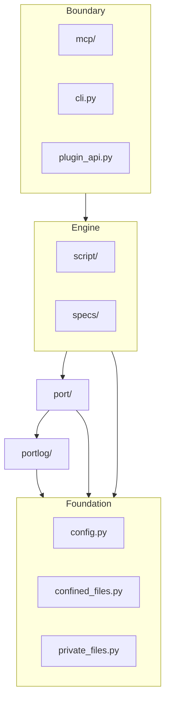

# Package Layout and Configuration Design

Status: draft, 9 October 2026. Three decisions are provisional until the user settles them (questions Q1 to Q3).
Once implemented, the code wins and this document is updated to match.
Basis: the user's request of 9 October 2026 to reorganize `serial_mcp_server/` by capability and to move all
configuration to one place, and the entanglement analysis summarized in section 1.1. No spec governs this work; the
refactor keeps every tool's observable behavior, except the configuration changes that section 8.1 lists.
Format: arc42, as in [the script runner design](script-runner-design.md).
Branch: `refactor/package-layout`, from `main` at `2a13952`.

## 1. Introduction and Goals

### 1.1 Requirements Overview

The package has 33 modules, 25 of them at the top level. The import graph has no cycles, but responsibilities are
spread across the wrong modules, so a reader cannot tell where a concern lives:

- Eighteen `SERIAL_MCP_*` variables are read in nine modules. Eight are read at import time and ten when a function
  runs, booleans are parsed three different ways, and an invalid value has four different outcomes: a crash at import, a
  warning with a fallback, a silent fallback, or an error on the call that uses it. The data-root resolver lives in
  `specs.py`, so `paths`, `portlog`, `trace`, `server`, and `handlers_script` import the spec feature to find a
  directory.
- The `serial_mcp_script` command imports `SerialConnection` and `stop_connections` from `state.py`, the MCP
  server's registry, and `state.py` itself imports the script runner and the mirror.
- `helpers.py` holds environment configuration, MCP response builders, and a state query.
- `mirror.py` holds the read buffer, the reader thread with its subscriber fan-out, and the PTY mirror.
- `portlog.py` holds the log thread, parsing of the log variables, and exclusive private-file creation, which the
  script runner also uses for result files.
- `handlers_serial.py` (1,084 lines) holds tool schemas, the open and close lifecycle, pacing arguments, wire-time
  estimates, and write-job orchestration. `handlers_file.py` imports four of those helpers from it.
- `script/runner.py` (804 lines) executes scripts and also builds and writes result files.
- The plugin template that `serial.plugin.template` generates imports `helpers._ok`, `state.SerialState`, and
  `handlers_serial` handlers, because no stable plugin interface exists.

The refactor must leave each concern in one module named for it, put all configuration in one module, and make the
dependency direction explicit and checkable.

### 1.2 Quality Goals

| Priority | Goal          | Meaning here                                                                                      |
| -------- | ------------- | ------------------------------------------------------------------------------------------------- |
| 1        | Findability   | A reader finds a concern from its package and file name, without reading imports.                |
| 2        | Configurability | Every setting, its default, and its validation are in one module, and an invalid value is reported once, by variable name. |
| 3        | Enforced layering | An import against the layer direction fails a check, not only a review.                      |
| 4        | No regressions | Tool names, schemas, results, files, and exit statuses stay as they are, except section 8.1.    |

### 1.3 Stakeholders

| Stakeholder      | Expectation                                                                 |
| ---------------- | --------------------------------------------------------------------------- |
| The maintainer   | Can find and configure each concern; reviews each move as its own commit.   |
| Operators        | Same variable names; clear startup errors for invalid values.              |
| Plugin authors   | One documented import path for what a plugin may use.                      |

## 2. Architecture Constraints

| Constraint                                                         | Source                          | Implication                                                                 |
| ------------------------------------------------------------------ | ------------------------------- | --------------------------------------------------------------------------- |
| The import package stays `serial_mcp_server`, directly under the repository root | User decision | No `src/` level. Subpackages and files sit directly under it.               |
| No needless nesting                                                 | User decision                   | No package that holds one module; no `port/port.py`-style repeats.          |
| Environment variable names stay the same                           | Operators' existing setups      | `SERIAL_MCP_SPEC_ROOT` keeps its name although it names the data root.      |
| `python -m serial_mcp_server`, `serial_mcp`, and `serial_mcp_script` keep working | README, `pyproject.toml` | Entry points change targets, not names.                                    |
| The script engine imports nothing from `mcp`                       | Script runner design, handoff   | The engine sits below the MCP layer.                                        |
| All tests run without hardware                                      | `CONTRIBUTING.md`               | Unchanged.                                                                  |

## 3. Context and Scope

In scope: the module and package structure of `serial_mcp_server/`, one configuration module, a stable plugin
interface, the layering check, and the test layout that mirrors the package. Out of scope: tool names and schemas,
script language, log formats, result structure, and new features. The deferred items of the two existing plans stay
deferred; consolidating them is a separate task.

## 4. Solution Strategy

Group modules by the capability they own, and order the groups in layers that depend only downward. Read every
setting once, at process start, into one immutable `Settings` object, and pass it to the code that needs it instead
of letting modules read the environment. Give plugins one public module. Move code without changing behavior, one
package per commit, so each step is reviewable and the tests stay green.

## 5. Building Block View

### 5.1 Overall Structure

```text
serial_mcp_server/
├── __init__.py, __main__.py, _version.py
├── config.py            # Settings: every SERIAL_MCP_* variable, read and validated once
├── confined_files.py    # read a file only inside an operator-chosen directory (was paths.py)
├── private_files.py     # create 0600 files exclusively, with collision-free names
├── cli.py               # the serial_mcp_script command (was script_cli.py)
├── plugin_api.py        # the public surface for plugins
├── port/                # one open serial port and its threads
│   ├── connection.py    # SerialConnection, stop_connections
│   ├── stack.py         # open_port_stack, conn_config
│   ├── buffer.py        # SerialBuffer
│   ├── reader.py        # ReaderThread and its subscriber fan-out
│   ├── mirror.py        # MirrorSession: the PTY mirror only
│   ├── pacing.py        # Pacing, NO_PACING, wire-time estimates
│   └── writer.py        # SerialWriter and write jobs
├── portlog/             # recording of the bytes on the wire
│   ├── log.py           # PortLog, PortLogSlot
│   ├── request.py       # LogRequest, built from arguments and Settings
│   └── formats.py       # entries and file formats (was portlog_formats.py)
├── script/              # the script engine (no mcp imports)
│   ├── model.py, expand.py, directives.py, parser.py, matcher.py, session.py
│   ├── runner.py        # execution only
│   ├── results.py       # run states, results, and result files
│   └── connection_session.py  # adapts a SerialConnection to PortSession
├── specs/               # protocol spec store
│   ├── frontmatter.py   # parse and validate front matter, spec ids
│   └── store.py         # index, register, list, read, search, template
└── mcp/                 # the MCP server
    ├── server.py        # build_server, main
    ├── state.py         # SerialState, ScriptJobs, ScriptRun
    ├── responses.py     # ok, err, result text, argument coercion, script_running_error
    ├── writes.py        # run_write_job and the write-duration check
    ├── plugins.py       # plugin discovery, loading, and the manager
    ├── trace.py         # tool-call tracing
    └── tools/
        ├── connection.py   # list_ports, open, close, configure, connection_status
        ├── io.py           # read, readline, read_until, write, flush
        ├── lines.py        # set_dtr, set_rts, pulse_dtr, pulse_rts
        ├── file.py, log.py, script.py, spec.py, trace.py, plugin.py, introspection.py
```

`tests/` mirrors this tree, so the tests of `port/writer.py` live in `tests/port/test_writer.py`.

### 5.2 Layers



A module may import from its own layer and from any layer below it, never from a layer above. `cli.py` and
`plugin_api.py` must not import each other, and `cli.py` must not import `mcp/`. An `import-linter` `layers`
contract in `pyproject.toml` enforces this order, and `just check` runs it, so a violating import fails the check.

### 5.3 Where Today's Code Goes

| Today                          | Goes to                                                                                                   |
| ------------------------------ | --------------------------------------------------------------------------------------------------------- |
| `helpers.py`                   | Settings fields to `config.py`; `_ok`, `_err`, `_result_text`, `_coerce_bool`, `script_running_error` to `mcp/responses.py`. The module ends. |
| `specs.resolve_spec_root`      | `config.py`, as the data-root default.                                                                    |
| rest of `specs.py`             | `specs/frontmatter.py` and `specs/store.py`.                                                             |
| `paths.py`                     | `confined_files.py`; `files_dir()` becomes `Settings.files_dir`.                                         |
| `state.py`                     | `SerialConnection`, `stop_connections` to `port/connection.py`; `SerialState`, `ScriptJobs`, `ScriptRun` to `mcp/state.py`. |
| `mirror.py`                    | `SerialBuffer` to `port/buffer.py`; `ReaderThread`, `_ReaderSubscriber`, `create_reader` to `port/reader.py`; `MirrorSession` and its index helpers to `port/mirror.py`. |
| `port_stack.py`                | `port/stack.py`.                                                                                          |
| `writer.py`                    | `Pacing`, `NO_PACING`, `MAX_PACING_DELAY_MS` to `port/pacing.py`; the rest to `port/writer.py`.          |
| `portlog.py`                   | `PortLog`, `PortLogSlot` to `portlog/log.py`; `LogRequest` and its builders to `portlog/request.py`; `open_exclusive`, `log_base_name`, file modes to `private_files.py`. |
| `portlog_formats.py`           | `portlog/formats.py`.                                                                                     |
| `handlers_serial.py`           | Tool handlers to `mcp/tools/connection.py`, `io.py`, `lines.py`; `paced_transfer_seconds`, `wire_seconds` to `port/pacing.py`; `run_write_job`, `duration_error` to `mcp/writes.py`; `parse_write_pacing` (tool arguments) to `mcp/tools/io.py`. |
| `handlers_<name>.py` (others)  | `mcp/tools/<name>.py`.                                                                                    |
| `server.py`                    | `mcp/server.py`.                                                                                          |
| `trace.py`                     | `mcp/trace.py`, with its settings from `config.py`.                                                       |
| `plugins.py`                   | `mcp/plugins.py`, with its policy from `config.py`.                                                       |
| `connection_session.py`        | `script/connection_session.py`.                                                                           |
| `script/runner.py`             | `RunState`, `RunMetadata`, `RunStatus`, `StepResult`, `RunFailure`, `RunResult`, and result-file writing to `script/results.py`; execution stays. |
| `script_cli.py`                | `cli.py`.                                                                                                 |

## 6. Runtime View

### 6.1 Server Start

`mcp/server.main` calls `config.load()`, which reads the environment once and returns a frozen `Settings`, or
raises `ConfigError` that lists every invalid variable with its value and the accepted form. `main` prints that
message to stderr and exits with status 2 before the MCP transport starts. On success, `main` configures logging
from `Settings.log_level` and builds the server with the settings. `SerialState` holds the `Settings`, so every tool
handler reads `state.settings` rather than the environment.

### 6.2 Command-Line Run

`cli.main` parses its arguments, calls `config.load()`, and overrides the loaded values with its flags:
`--log-dir` replaces `log_dir`, `--files-dir` replaces `files_dir`, and `--log-format` and `--no-log` replace the
log fields. A `ConfigError` exits 2, as an unusable input does today. The CLI passes the resulting `Settings` to
`open_port_stack` and to `ScriptRunner`.

## 8. Crosscutting Concepts

### 8.1 Configuration Model

`Settings` is a frozen dataclass with one field per variable. `config.load(environ=os.environ)` builds it; tests
call `Settings(...)` or `config.load({...})` with a mapping instead of changing the process environment. No module
outside `config.py` reads `os.environ`; a test in the suite searches the package for `os.environ` and `getenv`
outside `config.py` and fails on a match.

| Variable                         | Field                    | Type and default                                  |
| -------------------------------- | ------------------------ | ------------------------------------------------- |
| `SERIAL_MCP_SPEC_ROOT`           | `data_root`              | path; first `.serial_mcp/` up from the working directory, else next to `.git/`, else in the working directory |
| `SERIAL_MCP_FILES_DIR`           | `files_dir`              | path; `data_root/files`                           |
| `SERIAL_MCP_SCRIPTS_DIR`         | `scripts_dir`            | path; `data_root/scripts`                         |
| `SERIAL_MCP_LOG_DIR`             | `log_dir`                | path; `data_root/logs`                            |
| `SERIAL_MCP_LOG`                 | `log_enabled`            | boolean; off                                      |
| `SERIAL_MCP_LOG_FORMATS`         | `log_formats`            | list of `text`, `jsonl`, `lines`, `raw`; `text`   |
| `SERIAL_MCP_LOG_TEXT_TIMESTAMPS` | `log_text_timestamps`    | `off`, `elapsed`, or `system`; `off`              |
| `SERIAL_MCP_LOG_LEVEL`           | `log_level`              | `DEBUG`, `INFO`, `WARNING`, or `ERROR`; `WARNING` |
| `SERIAL_MCP_MAX_CONNECTIONS`     | `max_connections`        | positive integer; 10                              |
| `SERIAL_MCP_MAX_WRITE_SECONDS`   | `max_write_seconds`      | positive number; 60                               |
| `SERIAL_MCP_SCRIPT_MAX_SECONDS`  | `script_max_seconds`     | positive number; 3600                             |
| `SERIAL_MCP_MIRROR`              | `mirror`                 | `off`, `ro`, or `rw`; `off`                       |
| `SERIAL_MCP_MIRROR_LINK`         | `mirror_link`            | path; `/tmp/serial-mcp` when the mirror is on     |
| `SERIAL_MCP_PLUGINS`             | `plugin_policy`          | empty for none, `*` or `all`, or a list of names; empty |
| `SERIAL_MCP_TOOL_SEPARATOR`      | `tool_separator`         | string; `.`                                       |
| `SERIAL_MCP_TRACE`               | `trace_enabled`          | boolean; on                                       |
| `SERIAL_MCP_TRACE_PAYLOADS`      | `trace_payloads`         | boolean; off                                      |
| `SERIAL_MCP_TRACE_MAX_BYTES`     | `trace_max_bytes`        | positive integer; 16384                           |

An unset or blank variable means its default. Every boolean accepts `1`, `true`, `yes`, `on` and `0`, `false`, `no`,
`off`, in any case. Any other value of any variable is invalid, and `load` collects all invalid variables before it
raises, so one start reports every mistake.

These rules change observable behavior, and the CHANGELOG lists each change (provisional, Q1 and Q2):

- Settings are read once at start. Changing the process environment later no longer affects the next call. An MCP
  server over stdio cannot have its environment changed from outside after it starts, so only in-process callers
  such as tests saw the old behavior.
- `SERIAL_MCP_TRACE=off` now disables tracing; today it leaves tracing on, because only `0`, `false`, and `no` count
  as off.
- An invalid `SERIAL_MCP_MIRROR` stops the start instead of logging a warning and running with no mirror. An invalid
  `SERIAL_MCP_LOG_LEVEL` stops the start instead of silently using `WARNING`. An invalid
  `SERIAL_MCP_MAX_CONNECTIONS` or `SERIAL_MCP_TRACE_MAX_BYTES` stops the start with a message instead of a traceback.
- An invalid `SERIAL_MCP_MAX_WRITE_SECONDS`, `SERIAL_MCP_SCRIPT_MAX_SECONDS`, or log variable stops the start instead
  of failing each call that uses it with `invalid_params`.

### 8.2 Plugin Interface

`plugin_api.py` re-exports what a plugin may use, listed in `__all__`: `ok`, `err`, `SerialState`, `Tool`, and the
serial tool handlers plugins call today (`handle_write`, `handle_read`, `handle_readline`, `handle_read_until`).
Plugin modules keep their shape: `TOOLS`, `HANDLERS`, and handlers taking `(state, args)`. The template that
`serial.plugin.template` generates, the demo plugin, and the plugin documentation import from `plugin_api` only.
Names in `plugin_api.__all__` change only with a CHANGELOG entry.

Plugins that import the old module paths stop loading (provisional, Q3). The loader reports the failing import in
`serial.plugin.list` as it reports any load error today, and the CHANGELOG states the replacement imports.

### 8.3 Tests

Tests mirror the package tree and keep their names, so `tests/test_writer.py` becomes `tests/port/test_writer.py`.
Tests that set `SERIAL_MCP_*` variables with `monkeypatch.setenv` build a `Settings` instead. Each move keeps the
test count the same, except the tests that this design adds: the `config.load` cases of section 8.1, the
no-`os.environ` search, and the layering contract.

## 9. Architecture Decisions

| ID  | Decision                                                                                 | Status          | Rejected alternatives and why |
| --- | ---------------------------------------------------------------------------------------- | --------------- | ----------------------------- |
| L1  | Subpackages by capability: `port`, `portlog`, `script`, `specs`, `mcp`.                    | User decision   | The flat layout: concerns cannot be found. Packages by kind (`models/`, `utils/`): they collect unrelated code. |
| L2  | No `src/` level.                                                                          | User decision   | `src/` layout: adds the extra directory level the user rejected; its benefit, testing the installed package, comes cheaper from a CI job that builds the wheel and runs the tests against it. |
| L3  | One `config.py` with a frozen `Settings`, read once at start and passed down.              | Provisional (Q1) | Accessor functions that read the environment on each call: keeps today's semantics, but every consumer still depends on process state, and invalid values still surface late, at the call. |
| L4  | Invalid configuration stops the start with one message listing every invalid variable.    | Provisional (Q2) | Warn and fall back: an operator's typo silently changes behavior, as `SERIAL_MCP_TRACE=off` does today. |
| L5  | `plugin_api.py` is the only supported plugin import; old paths are not kept.               | Provisional (Q3) | Compatibility modules at the old paths: recreate the flat top level this design removes, for a 0.x package whose only known plugin is the demo. |
| L6  | An `import-linter` `layers` contract enforces section 5.2.                                | Recommended     | Review only: the interpreter and type checker accept a layer violation. |
| L7  | `cli.py` and `plugin_api.py` are top-level modules, not packages.                         | Recommended     | `cli/` and `plugins/` packages: each would hold one module. |

## 10. Quality Requirements

The refactor is done when the full test suite, `just check` with the layering contract, and `just integration`
pass; `rg 'os\.environ|getenv' serial_mcp_server` matches only `config.py`; and the package's top level holds only
the modules section 5.1 names.

## 11. Risks and Technical Debt

1. Most test imports change: about 110 import lines in the tests and the demo plugin name 27 module paths. Moving one package per commit keeps
   each diff reviewable, and the suite must pass after each.
2. User plugins generated from the old template break (Q3). The CHANGELOG entry and the loader's error carry the fix.
3. Reading settings once changes the behavior that section 8.1 lists. The tests that relied on `setenv` move to
   `Settings`, so a missed consumer shows as a failing test, and the `os.environ` search catches a stray read.
4. `run_write_job` and the duration check stay in the MCP layer, so a future non-MCP caller would need them moved
   down; nothing needs that today.

## 12. Glossary

| Term      | Meaning                                                                                              |
| --------- | ---------------------------------------------------------------------------------------------------- |
| Data root | The `.serial_mcp/` directory that holds files, scripts, logs, plugins, and specs; `SERIAL_MCP_SPEC_ROOT` overrides it. |
| Settings  | The immutable configuration object that `config.load` builds once per process.                       |
| Layer     | A group of packages that may import only from itself and the layers below it (section 5.2).          |

## Questions Register

| ID | Question | Recommendation | Consequence of the alternative |
| -- | -------- | -------------- | ------------------------------ |
| Q1 | Read settings once at start (L3)? | Yes. | Per-call reads keep in-process environment changes working but leave every module coupled to process state. |
| Q2 | Stop the start on any invalid value (L4)? | Yes, with one message listing all of them. | Keeping warnings and fallbacks preserves today's mixed behavior, including the `SERIAL_MCP_TRACE=off` bug unless fixed separately. |
| Q3 | Drop the old import paths for plugins (L5)? | Yes, with a CHANGELOG entry. | Compatibility modules keep old plugins loading but leave `helpers.py`, `state.py`, and `handlers_serial.py` at the top level. |

## Planning Handoff

The plan should order the moves so that each commit leaves the suite green: configuration first, because later
moves pass `Settings` instead of reading the environment; then `port/`, `portlog/`, the private and confined file
modules, `script/`, `specs/`, `mcp/`, `cli.py`, and `plugin_api.py`; and the layering contract last, once the tree
matches section 5.1. Obligations that need scrutiny: no tool's schema, result, or error code changes; every
`SERIAL_MCP_*` read goes through `config.py`; the engine still imports nothing from `mcp`; and the CLI and the MCP
server still produce the same result structure for the same run.
