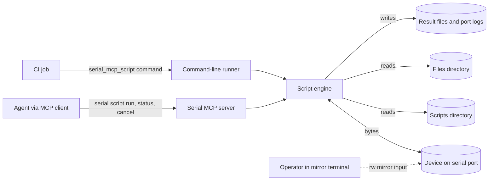
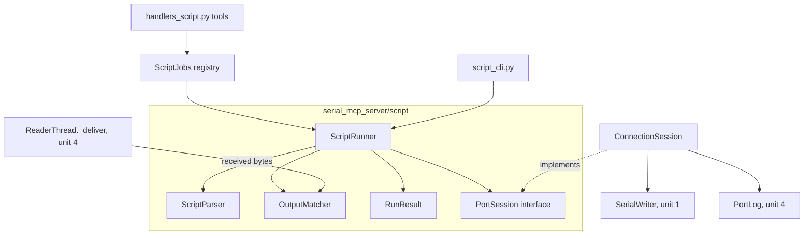
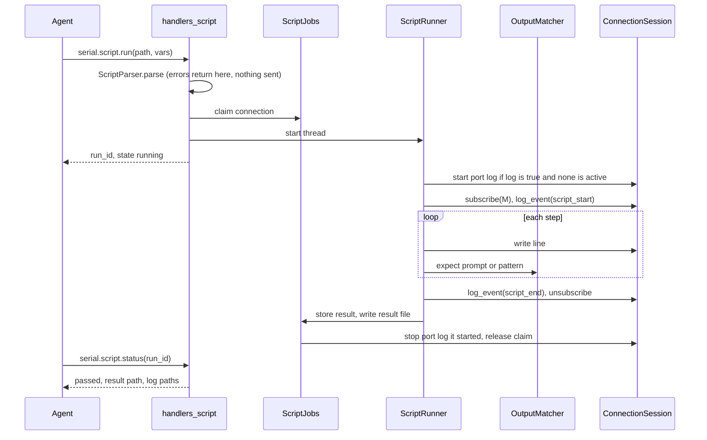
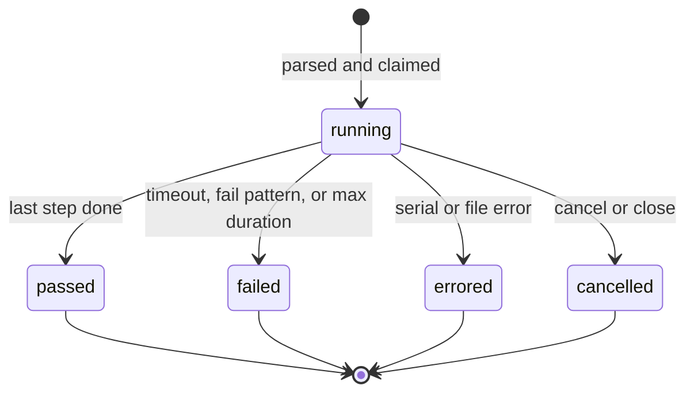

# Script Runner Design

Status: accepted by the user on 8 October 2026, after plan-critic review. Once implemented, the code wins and this
design is updated to match.
Design basis: the accepted request to "input files, like text files that are interpreted as commands to make for
automated testing setups", and the user's decisions on syntax, write ownership, logging, and a CI runner recorded
in [section 9](#9-architecture-decisions). No spec governs this work. The baseline is
`docs/plans/pacing-logging-scripts-implementation-plan.md` units 1 to 7, which this design builds on. Format:
arc42.
Open items: [section 11](#11-risks-and-technical-debt) and the [Planning Handoff](#planning-handoff).

## 1. Introduction and Goals

### 1.1 Requirements Overview

A test author writes a plain text file that drives a device's serial console: lines to send, output to wait for,
and output that means failure. The script runner executes that file against an open connection and reports pass
or fail, with the step that failed and the output around it. The agent can start a run, check on it, and cancel it
through MCP tools. A CI job runs the same file without an agent, through a command-line runner whose exit status
reports the outcome.

The runner covers linear console sessions: boot-loader checks, shell smoke tests, flashing sequences with
expected messages. Branching, loops, and multi-port scripts are out of scope (decision D7); the agent and
device plugins already cover logic that needs them.

### 1.2 Quality Goals

| Priority | Quality             | Scenario                                                                                                          |
| -------- | ------------------- | ----------------------------------------------------------------------------------------------------------------- |
| 1        | Reproducible result | The same script against a device that answers the same way yields the same outcome and the same failing line.    |
| 2        | Safe to hand over   | A script cannot run shell commands, read files outside one directory, or send anything before it fully parses.   |
| 3        | Diagnosable failure | A failed run names the script line, the reason, and the device output that preceded the failure.                 |
| 4        | Same engine twice   | The MCP tools and the command-line runner execute a script through the same code and report the same result.     |
| 5        | Server stays live   | A running script never blocks other tool calls, including reads, status, cancel, and other connections.          |

### 1.3 Stakeholders

| Role          | Needs from this design                                                                          |
| ------------- | ----------------------------------------------------------------------------------------------- |
| Test author   | A syntax that reads like the console session it automates, and failures that point at a line.   |
| Agent         | Tools to run, watch, and cancel scripts, and to compose a short script inline.                  |
| CI operator   | A command with stable exit codes and a machine-readable result file.                            |
| Implementer   | Settled grammar, run states, and component boundaries on top of plan units 1 to 7.              |

## 2. Architecture Constraints

| Constraint                                                                                 | Source                                  | Implication                                                                  |
| ------------------------------------------------------------------------------------------ | --------------------------------------- | ---------------------------------------------------------------------------- |
| Python 3.11 or later; `pyserial`; `mcp>=1.30.0,<2` with the low-level `Server` API          | `pyproject.toml`, `server.py`           | No new runtime dependencies; the runner uses the standard library only.     |
| Configuration through `SERIAL_MCP_*` environment variables                                  | `helpers.py`, plan Design Basis         | Script limits and directories are environment variables.                     |
| Tool names `serial.<category>.<action>`; handlers return `_ok`/`_err`                      | `CONTRIBUTING.md`                       | Tools are `serial.script.*` in a new `handlers_script.py`.                   |
| All tests run without hardware                                                              | `CONTRIBUTING.md`, `tests/conftest.py`  | The engine runs against an interface that a fake port can implement.        |
| One process owns a port at a time                                                           | README "Known limitations"              | The CLI and the MCP server cannot run against the same port concurrently.   |
| Writes go through the connection's `SerialWriter`; received bytes pass `_deliver`           | Plan units 1 and 4                      | The runner writes through the writer and reads through a `_deliver` tap.   |

## 3. Context and Scope



| Participant        | Exchange                                                                                                  |
| ------------------ | --------------------------------------------------------------------------------------------------------- |
| Agent              | Starts a run from a script path or inline source, polls status, cancels, lists scripts.                  |
| CI job             | Runs the command with a port, a script, and variables; reads the exit status and the result file.        |
| Device             | Receives sent lines and control-line changes; its output is matched and logged.                          |
| Scripts directory  | `SERIAL_MCP_SCRIPTS_DIR`, default `<spec root>/scripts/`. The only place the MCP tools load scripts from. |
| Files directory    | `SERIAL_MCP_FILES_DIR` from plan unit 7. `@send_file` resolves here.                                     |
| Result files, logs | Written to `SERIAL_MCP_LOG_DIR`, named like port logs.                                                   |
| Operator           | May type into a read/write mirror during a run; that input reaches the device and the port log.          |

The spec root is the `.serial_mcp/` directory that `resolve_spec_root()` in `serial_mcp_server/specs.py` finds.

## 4. Solution Strategy

| Goal                  | Approach                                                                                                       |
| --------------------- | -------------------------------------------------------------------------------------------------------------- |
| Reproducible result   | Linear scripts with explicit timeouts; expect semantics that consume output through each match (section 8.2). |
| Safe to hand over     | Parse and validate the whole script before sending a byte; no shell or include; confined directories.        |
| Diagnosable failure   | Each step records its outcome; a failure keeps the line, the reason, and the last 2 KiB of unmatched output.  |
| Same engine twice     | The engine depends on a `PortSession` interface, not on MCP; the MCP tools and the CLI share one adapter.   |
| Server stays live     | Each run executes on its own thread; MCP tools only start, inspect, and signal it.                          |

## 5. Building Block View

### 5.1 Overall Structure



The engine package has no MCP import, so the CLI can use it without the server. The MCP layer adds the job
registry and the tools. Both sides adapt a connection to `PortSession` with the same `ConnectionSession`.

| Component           | Responsibility                                                                                             | Interface                                                                 |
| ------------------- | ---------------------------------------------------------------------------------------------------------- | ------------------------------------------------------------------------- |
| `ScriptParser`      | Turns source text and variables into a `Script` of steps, or a list of errors with line numbers.           | `parse(source, vars, files_dir) -> Script` or raises `ScriptSyntaxError`. |
| `ScriptRunner`      | Executes steps in order on its own thread, enforces timeouts and fail patterns, honors cancel.            | `start()`, `cancel()`, `snapshot() -> RunStatus`, `result`.               |
| `OutputMatcher`     | Receives decoded device output and keeps the matcher window; the runner searches it.                     | `feed(bytes)`, `close()`, `interrupt()`, `wait(deadline)`, `discard()`.   |
| `PortSession`       | What the engine may do to a port: write, control lines, send a file, write log events, subscribe output.  | Protocol class; see 5.2.                                                  |
| `RunResult`         | The run's outcome, step records, and failure detail; serializes to the result file.                      | Dataclass with `to_json()`.                                               |
| `ScriptJobs`        | One active run per connection; the last 20 finished results; claim and release of a connection's writes. | Owned by `SerialState`.                                                   |
| `handlers_script`   | The `serial.script.*` tools.                                                                              | Section 5.3.                                                              |
| `ConnectionSession` | Adapts a managed `SerialConnection` to `PortSession`; it lives in an `mcp`-free module.                  | Built by `serial.script.run` and by `script_cli`.                         |
| `script_cli`        | Opens a port with the same reader, writer, and port log stack, runs one script, and exits.               | Console entry point `serial_mcp_script`.                                  |
| Port stack opener   | Builds the writer, reader, and port log slot for an open port; shared by `serial.open` and the CLI.      | An `mcp`-free function, so the CLI need not import the MCP handlers.      |

### 5.2 Port Session Interface

`PortSession` is the engine's only route to hardware:

```python
class PortSession(Protocol):
    newline: str
    encoding: str

    def write(self, data: bytes, pacing: Pacing | None, cancel: threading.Event) -> int: ...
    def send_file(self, path: Path, pacing: Pacing | None, cancel: threading.Event) -> int: ...
    def set_line(self, line: Literal["dtr", "rts"], value: bool) -> None: ...
    def log_event(self, name: str, **fields: Any) -> None: ...
    def subscribe(self, matcher: OutputMatcher) -> Callable[[], None]: ...
```

`write` and `send_file` submit to the connection's `SerialWriter` and block until the job ends, passing the
cancel event so a cancelled run stops a paced write between segments (plan unit 2). `subscribe` registers the
matcher with `ReaderThread._deliver` and returns the function that removes it. `log_event` is a no-op when no
port log is active.

### 5.3 MCP Tools

| Tool                     | Inputs                                                                                                   | Returns                                                                       | Annotations                         |
| ------------------------ | -------------------------------------------------------------------------------------------------------- | ----------------------------------------------------------------------------- | ----------------------------------- |
| `serial.script.run`      | `connection_id`; one of `path` or `source`; `vars`; `log` (default true); `log_formats`; `wait_ms`      | `run_id`, `state`; the full result when the run ends within `wait_ms`         | destructive, open-world             |
| `serial.script.status`   | `run_id`, or `connection_id` for its latest run                                                          | State, current line and its text, step counts, elapsed time; after the run ends, also failure, output tail, result and log paths | read-only |
| `serial.script.cancel`   | `run_id`                                                                                                 | Final state after the runner stops                                            | destructive                         |
| `serial.script.list`     | none                                                                                                     | Scripts in the scripts directory with size and their first comment line       | read-only                           |
| `serial.script.template` | none                                                                                                     | The syntax reference and a skeleton script, like `serial.spec.template`       | read-only                           |

`path` is relative to the scripts directory and is checked like plan unit 7's file paths: it must resolve to a
regular file strictly inside the directory. `source` is inline text up to 256 KiB, for short scripts the agent
composes. `wait_ms` ranges from 0 to 60,000; the default 0 returns at once. `vars` maps names to string values.

While a run is active, the connection rejects `serial.write`, `serial.send_file`, `serial.configure`,
`serial.flush`, `serial.set_dtr`, `serial.set_rts`, `serial.pulse_dtr`, `serial.pulse_rts`, and
`serial.log.start` and `serial.log.stop` with the error code `script_running`, whose message names the run.
Reads, `serial.connection_status`, `serial.log.mark`, and `serial.log.status` still work. `serial.close` cancels
the run first (section 6.4). A second `serial.script.run` on the same connection returns `script_running`.

## 6. Runtime View

### 6.1 A Run Started by the Agent



1. `handlers_script` parses the whole script with its variables. A syntax error, an undefined variable, or a
   `@send_file` path that does not resolve returns `invalid_params` with every error and its line; nothing is sent.
2. `ScriptJobs` claims the connection. From here, the write tools listed in 5.3 return `script_running`.
3. `ScriptRunner` starts on its own daemon thread and the tool returns, unless `wait_ms` is set.
4. The runner starts a port log in the default formats when `log` is true and the connection has none, subscribes
   its `OutputMatcher`, and writes a `script_start` event with the script name and its SHA-256.
5. Each step runs in order (section 8.1). Output that arrived before the subscription is not visible to the run.
6. After the last step, the runner writes `script_end`, removes the subscription, and writes the result file. The
   job registry then stops the port log, only if the run started it, and releases the claim.

### 6.2 A Failing Expect

For `@expect "Bytes transferred" --timeout 60s`, the runner waits on the matcher and searches its window after
each wake. Sixty seconds pass without a match. The step's outcome becomes `timeout`, the run's state becomes `failed`, and the failure records
the line number, the step text, the reason, and the last 2 KiB of unmatched output. Remaining steps do not run.
Teardown proceeds as in 6.1. A fail pattern that matches during a wait or between steps ends the run the same way
with the reason `fail_pattern` and the matched text. It is not checked while one write is in flight (section 11,
risk 5).

### 6.3 Cancel

A run has one stop event. `serial.script.cancel` sets it, calls `OutputMatcher.interrupt()` to wake any waiter,
and waits up to five seconds, off the event loop, for the runner thread to finish. Every wait in the runner ends
promptly when the stop event is set: expect and `@sleep` both wait on the matcher's condition until their
deadline, and writes pass the stop event to the writer job, which checks it between segments. The run ends as
`cancelled` with the step it was on, then tears down as in 6.1.

A pattern search in flight cannot be interrupted, but it ends within its two-second limit (8.2), well inside the
five-second wait. The stop cause outranks a search that timed out, so the run ends `cancelled`. If the runner is
still alive after five seconds anyway,
`serial.script.cancel` returns the state at that moment with `cancel_requested: true`. The run keeps its claim
until the runner thread returns, then ends `cancelled` and releases it.

### 6.4 Connection Closed or Device Lost

`serial.close` cancels an active run as in 6.3 before stopping the reader and writer. If the runner outlives the
wait, closing the writer makes its next write fail with `WriterClosed`, which ends the run `cancelled`. A write
that fails with a serial error ends the run as `errored` with the cause. When the reader thread stops after
repeated errors, it calls `close()` on each subscriber; the matcher records end of stream and wakes the runner,
which ends the run as `errored`. A subscriber that raises inside `feed` is removed and marked failed, which also
ends its run as `errored` rather than letting it time out with a misleading reason.

Server shutdown sets every run's stop event without waiting, because the server allows `SerialState.shutdown`
only 0.25 seconds. The stop sequence of plan unit 1 then signals and joins the readers and writers.

### 6.5 A CI Run

The CI job runs:

```bash
serial_mcp_script tests/uboot-smoke.serial --port /dev/ttyUSB0 --baud 115200 \
  --var SERVER_IP=10.0.0.1 --var IMAGE=fitImage --result build/uboot-smoke.json
```

`script_cli` opens the port, builds the reader, `SerialWriter`, and port log, adapts them with `ConnectionSession`, and
starts the runner, then waits for it on the main thread. Progress lines go to stderr. On completion it writes the result file
and exits with 0 for passed, 1 for failed, 2 for an errored run or unusable input (a usage or parse error, a port
that cannot be opened, an existing `--result` file, a run that ends cancelled without an interrupt, or an unexpected
error), and 130 when interrupted by SIGINT, which cancels the run first. SIGTERM is not handled: it ends the
command at once and writes no result file.

## 7. Deployment View

The engine runs inside whichever process owns the port. In the MCP server, each run adds one daemon thread beside
the connection's reader, writer, and port log threads. The CLI is a separate process with the same thread set for
one connection. Because a serial port has one owner, a CI job must not run the CLI against a port the MCP server
holds open. The CLI opens the port with an exclusive lock, so the open fails, and the CLI reports exit 2, when the
other holder also took an exclusive lock. The operating system lets a plain open share the port, so the lock cannot
stop a holder that did not ask for one.

## 8. Crosscutting Concepts

### 8.1 Script Language

A script is UTF-8 text. The parser reads it line by line and strips the line terminator (`\n` or `\r\n`).

| Line form              | Meaning                                                                                                   |
| ---------------------- | --------------------------------------------------------------------------------------------------------- |
| blank or whitespace    | Ignored.                                                                                                  |
| `# text`               | Comment, after optional leading whitespace.                                                               |
| `@@text`               | A bare line whose content starts with `@`: sends `@text`.                                                 |
| `@name args`           | A directive, only when `@` is in column zero. Most directives split their arguments with `shlex` in POSIX mode, so quotes group words; `@send`, `@sendline`, `@sendhex`, `@newline`, and `@mark` take the rest of the line, trimmed, with no quote processing. |
| anything else          | A bare line: sent as written, leading whitespace included (an indented `@expect` is sent as text), followed by the script's newline, then the prompt wait if one is set. |

The first comment line of a file is its description in `serial.script.list`.

Directives:

| Directive                                   | Effect                                                                                                  |
| ------------------------------------------- | ------------------------------------------------------------------------------------------------------- |
| `@send TEXT`                                | Send the rest of the line with escapes `\r`, `\n`, `\t`, `\xHH`, `\\` decoded, and no newline. `\xHH` is Unicode code point HH, encoded with the connection's encoding; any other escape is a parse error. |
| `@sendline TEXT`                            | As `@send`, then the newline and the prompt wait. For lines that start with `#` or `@`, or need escapes. |
| `@sendhex HEX`                              | Send raw bytes given in hex; spaces are allowed.                                                       |
| `@expect REGEX [--timeout D]`               | Wait for REGEX in output after the cursor, then move the cursor past the match (section 8.2).          |
| `@prompt REGEX` / `@prompt --off`           | After each bare line and `@sendline`, wait for REGEX with the current timeout, consuming it.           |
| `@fail_on REGEX` / `@fail_on --clear`       | From now on, any output matching REGEX fails the run. Several patterns may be active.                  |
| `@timeout D`                                | Default timeout for `@expect` and the prompt wait. Initially `10s`.                                    |
| `@sleep D`                                  | Wait D. Fail patterns stay active.                                                                     |
| `@discard`                                  | Drop all output received so far from the matcher window.                                               |
| `@dtr on\|off`, `@rts on\|off`              | Set a control line.                                                                                    |
| `@pulse dtr\|rts D`                         | Set the line low for D, then high, as `serial.pulse_dtr` does.                                         |
| `@pacing off`, `@pacing char D`, `@pacing chunk N D` | Pacing for the script's later writes. Without it, the connection's pacing applies.            |
| `@newline TEXT`                             | Newline for later bare lines, with escapes decoded; the rest of the line. Initially the connection's newline. |
| `@mark LABEL`                               | Write a `mark` event to the port log and record it in the result; the label is the rest of the line.   |
| `@send_file PATH`                           | Send a file from the files directory with the current pacing, as `serial.send_file` does.              |

A duration D is a number with a unit: `ms`, `s`, or `m`. A bare number is a syntax error, because a missing unit
is ambiguous. Settings made by `@pacing`, `@newline`, `@timeout`, `@prompt`, and `@fail_on` last until the run
ends and never change the connection's configuration.

Variables are written `{{NAME}}`, where NAME is a letter or underscore followed by letters, digits, or
underscores. The parser replaces them in bare lines and directive arguments after splitting arguments, so a value
with spaces or quotes stays one argument. The text directives decode escapes before substitution, so a backslash
in a value stays literal. Inside a REGEX argument, the value is inserted with `re.escape`, so it matches
literally. An undefined name is a parse error. `${...}` is left alone, because U-Boot and shells use it themselves
(decision D2).

An example:

```text
# U-Boot smoke test
@timeout 10s
@prompt --off
@fail_on "(?i)error|panic"

version
@expect "U-Boot 20\d\d"
@expect "=> "
@prompt "=> "
printenv bootcmd
setenv serverip {{SERVER_IP}}
@mark tftp
@prompt --off
tftpboot ${loadaddr} {{IMAGE}}
@expect "Bytes transferred" --timeout 60s
@expect "=> "
```

### 8.2 Matching Model

The matcher holds the device output received since the run subscribed, decoded with the connection's encoding
through an incremental decoder with `errors="replace"`. A cursor marks the start of unconsumed output. `@expect`
and the prompt wait search from the cursor; on a match, the cursor moves past the match's end, so the same output
cannot satisfy two expects. This follows pexpect, where a match keeps only the output after it buffered for the
next `expect()` ([pexpect 4.9 `expect.py`](https://raw.githubusercontent.com/pexpect/pexpect/4.9/pexpect/expect.py)).
Patterns are [`regex`](https://pypi.org/project/regex/) patterns in its default `VERSION0` mode, which accepts `re`
syntax, with no flags; authors use inline flags such as `(?i)` or `(?m)`. The parser validates patterns with the same
engine, so a pattern that parses also compiles in the runner.

`OutputMatcher.feed` runs on the reader thread, so it only decodes, appends, and notifies; it never evaluates a
pattern. The runner thread checks fail patterns whenever it wakes, over the text received since its last check
joined with the 256 characters before it, so a pattern split across two chunks still matches. Fail patterns see
all output, consumed or not. Keeping pattern evaluation off the reader thread means a slow pattern can delay only
its own run, never receiving or the mirror.

Every search calls `search(text, timeout=2.0, concurrent=True)`. The `timeout` makes the engine itself stop a match at
the limit and raise `TimeoutError`, and the run ends `errored` with the reason `regex_timeout`. `concurrent=True`
releases the interpreter lock during the match, so a slow search cannot freeze the event loop, the readers, or
cancel. Measured on CPython 3.13 with `regex` 2026.9.29, `(a|aa)+$` against 40 `a` characters followed by `b`
timed out at the limit, and another thread kept its 20 ms ticks throughout; without `concurrent=True` it stalled for
the whole search. `re` holds the lock for a whole match and has no timeout, and a signal-based limit cannot reach the
runner thread, because Python runs signal handlers only on the main thread.

The window keeps at most 1 MiB of unconsumed text. Past that, the oldest text is dropped, the drop is counted, and
the result records `window_overflow` with the count. pexpect has no such bound; this one keeps a long silent
expect from growing memory.

A device usually echoes what it receives, and the echo is output. `@expect ls` right after the bare line `ls`
matches the echo, not the command's result. Authors anchor expects on output the echo cannot contain, or set
`@prompt` so each line's output is consumed through the next prompt. `serial.script.template` states this.

### 8.3 Run States and Results



A parse error never creates a run; the tool or command reports it directly. A run longer than
`SERIAL_MCP_SCRIPT_MAX_SECONDS` (default 3600) fails with the reason `max_duration`. The limit is checked between
steps and while the runner waits, not while one write is in flight (section 11, risk 5).

The result file is `serial-mcp-script-<DDMMYYYY>-<HHMM>[-n].json` in the log directory, numbered like port logs.
It holds a schema version, the script name (the path the tool was given, the file name the command was given, or `inline`), its SHA-256, the variable names, the connection's
configuration, UTC start and end times, the state and reason, one record
per executed step (line, text, kind, start offset, duration, outcome, and matched text for expects), marks, the
failure detail, and the port log paths. `serial.script.status` returns the same structure. The registry keeps
the last 20 finished results per server process.

Step text in results and status is the script's source text before substitution, so it shows `{{SERVER_IP}}`, not
the address. Variable values never appear in the variable list or in step text. Device output is recorded as
received: when the device echoes or prints a value, the output tail and matched text contain it, as the port log
does. Redacting values from device output was rejected, because the record would then differ from what the device
sent, and a short value such as `1` would corrupt unrelated text.

### 8.4 Safety Boundaries

The language has no shell escape, no include, and no file access except `@send_file` from the files directory.
The MCP tools load scripts only from the scripts directory or from inline `source`, which can do nothing that a
sequence of `serial.write` calls could not. The CLI runs with the operator's authority and accepts any script
path, but `@send_file` still resolves inside the files directory, `--files-dir` or `SERIAL_MCP_FILES_DIR`.
Variable values reach the device and the port log, which is created `0o600` (plan unit 4). Section 8.3 states
where they may appear in results.

## 9. Architecture Decisions

| ID  | Decision                                                                                                 | Status          | Rejected alternatives and why                                                                                                                                                                                                                                                                                                                                                                                           |
| --- | -------------------------------------------------------------------------------------------------------- | --------------- | ------------------------------------------------------------------------------------------------------------------------------------------------------------------------------------------------------------------------------------------------------------------------------------------------------------------------------------------------------------------------------------------------------------------------------- |
| D1  | Bare lines are sent; directives start with `@`.                                                          | User decision   | Explicit directives only: every sent line needs `sendline`, which buries the session. YAML steps: noisy to write and diff for console sessions.                                                                                                                                                                                                                                                                        |
| D2  | Variables are `{{NAME}}` and undefined names fail parsing.                                                | Accepted        | `${NAME}`: U-Boot and shells use it, so `tftpboot ${loadaddr}` would be rewritten before reaching the device.                                                                                                                                                                                                                                                                                                          |
| D3  | The matcher subscribes at `_deliver` with its own window.                                                 | Accepted        | Matching on `SerialBuffer`: agent reads would steal output from a running expect, and the outcome would depend on timing.                                                                                                                                                                                                                                                                                             |
| D4  | Runs execute in the background; the agent polls `serial.script.status`, with optional `wait_ms`.         | Accepted        | One blocking tool call: client request timeouts end long runs. MCP tasks: experimental in spec revision 2025-11-25 and moved to the `io.modelcontextprotocol/tasks` extension in revision 2026-07-28, and the SDK 1.x experimental API is deprecated ([changelog](https://modelcontextprotocol.io/specification/2026-07-28/changelog)). Progress notifications alone: they still need a blocking call and a client token. |
| D5  | A run owns its connection's writes and control lines; reads and the mirror stay open.                    | User decision   | Interleaving agent writes: the agent could break a test mid-run.                                                                                                                                                                                                                                                                                                                                                      |
| D6  | A run starts a port log in the default formats unless it passes `log: false`.                            | User decision   | Following the global default: a failed test would often have no device output to read.                                                                                                                                                                                                                                                                                                                               |
| D7  | Scripts are linear: no branches, loops, labels, or includes; the first failure ends the run.             | Accepted        | minicom runscript's `goto`, `gosub`, and `if` ([runscript(1)](https://manpages.debian.org/unstable/minicom/runscript.1.en.html)): control flow makes results harder to reproduce and review; the agent and plugins hold logic.                                                                                                                                                                                          |
| D8  | The engine is an MCP-independent library with a `serial_mcp_script` command.                             | User decision   | MCP-only runner: CI would need an agent to run tests.                                                                                                                                                                                                                                                                                                                                                                  |
| D9  | Patterns match decoded text.                                                                              | Accepted        | Byte patterns: harder to write for console output. Binary protocols belong in plugins; `@sendhex` covers raw sends.                                                                                                                                                                                                                                                                                                  |
| D10 | Patterns use the `regex` package; each search has a two-second `timeout` and releases the interpreter lock. | User decision   | A `SIGALRM` context manager: signal handlers run only on the main thread, and the runner thread never is. A child process per run that is killed at the limit: works with `re`, but adds a process lifecycle, a wire protocol, and orphan handling for what the library already does. Screening for nested quantifiers: misses ambiguous alternations. |

## 10. Quality Requirements

The user accepted the quality goals in section 1.2 with this design; no spec sets thresholds.
The numeric limits in this document (1 MiB window, 256 KiB inline source, 2 KiB failure output, 20 kept results,
3600 s maximum run, 10 s default timeout, 5 s cancel wait) are accepted defaults.

## 11. Risks and Technical Debt

1. A pattern with catastrophic backtracking is bounded by the search timeout (8.2) and ends the run `errored` with
   the reason `regex_timeout`. Two costs remain. The limit is fixed, so a legitimate pattern that needs longer
   cannot run. A cancel cannot interrupt a search, so it can wait up to the limit before the run ends. The `regex`
   dialect also differs from `re` in a few corner cases, which a script written against `re` may hit.
2. Operator input through a read/write mirror reaches the device mid-run and can change the outcome. It is logged
   with source `mirror`, which makes it visible in the port log, but the result does not flag it.
3. A failed run leaves the device where the failure happened, because there is no cleanup block. A `@finally`
   section is deferred; a CI job can run a separate reset script.
4. A device that echoes with different line endings or colors can defeat a pattern written against the plain
   text. Authors see the received text in the failure output.
5. A write that is already in flight runs to its end: the stop event ends it between segments, but
   `SERIAL_MCP_SCRIPT_MAX_SECONDS` and fail patterns are checked only when it returns, and a script's writes skip
   `SERIAL_MCP_MAX_WRITE_SECONDS`. A long paced `@send_file` can therefore outlast the run's maximum duration. Text
   that the connection's encoding cannot encode is found when its step runs, because `parse` takes no encoding.
   Accepted and stated in `docs/scripts.md`.

## 12. Glossary

| Term            | Meaning                                                                                      |
| --------------- | -------------------------------------------------------------------------------------------- |
| Script          | A text file or inline source in the language of section 8.1.                                 |
| Bare line       | A script line that is not blank, a comment, or a directive; it is sent to the device.        |
| Directive       | A script line starting with `@` that the runner interprets.                                  |
| Step            | One bare line or directive, executed in order and recorded in the result.                    |
| Run             | One execution of a script on one connection, identified by `run_id`.                         |
| Matcher window  | The device output a run has received and not yet consumed.                                   |
| Cursor          | The start of unconsumed output in the matcher window.                                        |
| Fail pattern    | A pattern that fails the run whenever it appears in output.                                  |
| Claim           | A run's exclusive hold on its connection's writes and control lines.                         |

## Planning Handoff

The design depends on these plan units: the `SerialWriter` and its jobs (unit 1), cancellable jobs (unit 2), the
port log with `_deliver` and `PortLogSlot` (unit 4), and `serial.send_file` with its path checks (unit 7). It does
not need `serial.configure` (unit 3), because script settings are run-scoped.

Obligations that need particular scrutiny in review and tests:

- Nothing reaches the device before the whole script parses and validates (section 6.1, step 1).
- The claim is released on every exit path: pass, fail, error, cancel, close, and an exception in the runner.
- Every runner wait ends on the stop event, and cancel completes within one pacing segment or matcher wake; a write
  still queued behind other writes is removed when the run is cancelled.
- No pattern is evaluated on the reader thread.
- Expect consumption follows section 8.2, including chunk-split fail patterns and the window bound.
- Variable values never appear in the variable list or step text of results and status output.
- The engine package imports nothing from `mcp`, so it needs path checks and port setup in `mcp`-free modules.
- The CLI and the MCP tools produce the same result structure for the same run.

No consequential question remains open. Implementation-local choices left to the plan include module file names
inside `serial_mcp_server/script/`, the exact text of the template, and the format of CLI progress lines.
