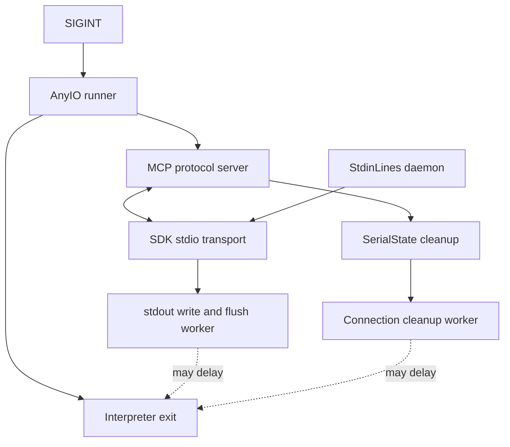

# SIGINT Shutdown Design

Status: initial design draft. The historical hang is confirmed; its cause and the corresponding fix remain open.

Basis: the user's request to select and design the next roadmap fix, from `v0.2.3` (`f546f02`). The scope is the\
[server outliving Ctrl-C](../roadmap.md#the-server-sometimes-outlives-ctrl-c). This follows the repository's arc42\
design convention. No separate specification governs this bounded defect repair; existing behavior supplies the\
compatibility contract. This draft does not authorize implementation.

Open questions and design progress live in sections 9 and 11 below. No device access is needed.

## 1. Introduction and Goals

An MCP client can keep the server's stdin pipe open after sending SIGINT. The server must still exit cleanly after one\
interrupt. A historical CI run exceeded the existing test's five-second deadline after initialization completed. The\
operator should not need to close stdin or send another signal to end an idle server.

The existing regression requires exit status zero and no traceback. Preserve that contract, JSON-RPC framing, and\
normal EOF handling. Five seconds is the regression's existing tolerance, not a new shutdown service guarantee.

## 2. Architecture Constraints

Use AnyIO rather than direct asyncio APIs in project code. Preserve the supported Python and dependency ranges unless a\
reproduced upstream defect establishes that a minimum version must change.

Production input currently uses a daemon thread and unbuffered descriptor reads. It must remain possible to exit while\
stdin stays open. Do not reintroduce a worker blocked indefinitely in buffered stdin or join that daemon.

Forced process exit, silent abandonment of log output, and a new repeated-interrupt policy require separate decisions.\
This draft proposes none of them. All investigation and verification use subprocess pipes, fakes, or pseudo-terminals.

## 3. Context and Scope

The affected boundary is the standalone server process, from receiving SIGINT through transport teardown and resource\
cleanup to interpreter exit. Protocol clients supply stdin and consume stdout; process supervisors observe exit status.

The separate roadmap items for an unbounded script cleanup join and worker threads outliving a shutdown deadline are\
adjacent evidence paths. They are not assumed causes of this incident. The failing test opens no serial connection.

## 4. Solution Strategy

Identify the wait that survives the first SIGINT before choosing a correction. Distinguish failure to leave protocol\
serving, failure to unwind transport tasks, failure in connection cleanup, and failure after the async runner returns.\
Thread stacks alone can miss the async task that owns a wait, so retain both thread and task-phase evidence.

Recommend the smallest correction at the demonstrated boundary. A dependency minimum change is appropriate only if the\
supported floor reproduces the defect and a specific newer version removes it. A project lifecycle change is\
appropriate only if a controlled reproduction exposes a project-owned cancellation or resource-ownership error.

Passing repeated timing-based tests does not identify the cause. A deterministic regression must establish the relevant\
interleaving before a fix can be considered justified.

## 5. Building Block View

| Component | Current responsibility and design obligation |
| -- | -- |
| Server entry point | Loads settings, invokes the AnyIO runner, and treats KeyboardInterrupt as a normal exit. |
| MCP protocol server | Owns request/session task groups; in-flight handlers must unwind when serving stops. |
| SDK stdio transport | Owns stdin and stdout transport tasks; stdout write and flush use AnyIO file operations. |
| StdinLines | Reads descriptor bytes in a daemon thread and delivers complete lines through a memory stream. |
| SerialState cleanup | Cancels scripts and offloads connection shutdown to a worker, abandoning its await on cancellation. |
| Interpreter | Can still wait for non-daemon threads after async shutdown; a returned await is not proof of process exit. |

The current control path crosses several independently owned cancellation scopes:

The diagram identifies diagnostic boundaries, not a confirmed failure path or a proposed replacement transport.

## 6. Runtime View

### 6.1 Existing Interrupt Scenario

The client sends initialize and receives its response, then sends SIGINT while keeping stdin open. Cancellation must\
leave protocol serving and unwind transport tasks. The server's finally block then attempts resource cleanup and closes\
the trace sink. The entry point accepts KeyboardInterrupt, and the process exits without waiting for stdin EOF.

Receiving the response proves that stdout bytes reached the client. It does not prove that the SDK's subsequent flush\
or its initialization handler has completed. The regression therefore exercises a potentially important overlap.

### 6.2 Proposed Failure Classification

Record whether serving returned, transport teardown completed, cleanup began and ended, and the entry point returned.\
Use test-only phase barriers to hold and release specific operations without changing production scheduling.

If transport tasks remain alive, inspect their awaited operations and cancellation scopes. If the entry point returns\
but the process remains alive, inspect non-daemon worker ownership instead. If cleanup is entered but not left,\
identify its concrete blocking operation. A blocked stdout worker and an uncancelled memory-stream receive need\
different fixes.

Diagnostic output must stay on stderr and contain phase names, thread names, and stack locations only. Do not include\
tool arguments, environment values, serial bytes, or device details.

## 8. Crosscutting Concepts

An AnyIO cancellation deadline bounds an asynchronous wait only when the called operation permits cancellation.\
Abandoning a worker's await does not stop its underlying thread. The server's existing 0.25-second cleanup scope\
therefore cannot establish a process-wide exit bound by itself.

Keep cancellation propagation separate from routine EOF and broken-stream handling. Do not suppress unexpected\
exceptions merely to obtain exit status zero. Preserve the original diagnostic stack when a regression times out.

## 9. Architecture Decisions and Questions

| Question | Recommendation | Status and evidence needed |
| -- | -- | -- |
| Which boundary retains the process after SIGINT? | Select a correction only after phase/task evidence isolates it. | Open; historical CI predates the faulthandler addition. |
| Raise the AnyIO minimum or change project lifecycle? | Prefer the demonstrated cause-level correction. | Provisional alternatives; require a controlled failing case and comparison against a specific fixed version. |
| Replace SDK stdio or install a custom signal handler? | Keep both unless the isolated failure requires changing one. | Provisional; either replacement expands ownership and compatibility obligations. |
| Include global forced-exit or slow-resource policy? | Keep it outside this repair unless reproduction requires it. | Open only if causal evidence reaches that boundary; it would need a user decision. |

The design is not ready for acceptance or implementation planning while its causal question remains open. An interview\
would currently ask the user to guess an internal cause. Defer that pressure test until a concrete correction is\
available; then examine dependency compatibility and any changed cleanup obligations before acceptance.

## 10. Quality Requirements

The authoritative regression is\
[`test_the_server_exits_on_sigint_while_its_client_keeps_stdin_open`](../../tests/mcp/test_stdin.py). It requires one\
SIGINT, open client stdin, exit within five seconds, status zero, and no traceback.

Qualify the eventual correction at the demonstrated signal/transport overlap, with both the lowest supported\
dependencies and the locked dependencies. Preserve line order, split UTF-8 input, EOF delivery, and cancellation of an\
idle input wait. Keep slow cleanup and blocked-output tests separate so a passing idle case cannot hide those gaps.

## 11. Evidence, Risks, and Design Ledger

### Evidence Register

The [historical failure](https://github.com/jonatsu/serial-mcp-server/actions/runs/38062908269) used Python 3.11.17,\
AnyIO 4.11.0, and MCP 1.30.0. Its test timed out after SIGINT; 812 other tests passed. It contains no child stack dump.\
The current regression adds faulthandler and requests thread stacks on timeout.

Repository inspection covers the server entry point, StdinLines, state cleanup, and their current tests. Installed MCP\
1.30.0 source shows the stdio write followed by flush and the protocol server's task-group cancellation. Inspection of\
the AnyIO 4.11.0 implementation does not establish a specific upstream cancellation defect.

An isolated local baseline with Python 3.13.16, AnyIO 4.11.0, and MCP 1.30.0 passed all four stdin tests. This is not a\
reproduction of the historical Python 3.11 environment. Python 3.11 is unavailable under the shell's system-only\
interpreter policy; that policy was preserved. The published release's lowest-dependency CI job also passed, so the\
existing diagnostic has not supplied a fresh failing stack.

### Design Ledger

| Work | State | Next action or result |
| -- | -- | -- |
| Release publication | Complete | v0.2.3 release, notes, wheel, and source archive verified; release CI, main CI, and CodeQL succeeded. |
| Prioritize next defect | Complete | Select Ctrl-C exit reliability; rendering qualification still needs additional setup and authorization. |
| Read incident and lifecycle | Complete | Historical timeout confirmed; component boundaries identified; cause remains unknown. |
| Focused floor-dependency baseline | Partial | Four tests pass on available Python; exact historical Python environment remains unqualified locally. |
| Checkpoint validation | Complete | Checks, hooks, and all 878 tests pass. |
| Commit signing | User approval required | The Bitwarden SSH agent requires approval at the laptop; retry a refused signature when the user is available, keeping signing enabled. |
| Isolate causal interleaving | Open | Obtain task/phase evidence and a controlled failing case before selecting the production correction. |
| Settle correction and compatibility | Open | Resolve section 9 from causal evidence, then pressure-test the concrete design. |
| User acceptance and implementation plan | Not started | Present a complete correction for acceptance before planning or production edits. |

## Planning Handoff

This initial draft is an investigation checkpoint, not an implementation handoff. Do not replace the transport, raise\
dependency requirements, add forced termination, or claim the shutdown defect fixed from the passing baseline. The next\
design step is to isolate the surviving wait while preserving the existing exit and data-handling contracts.
